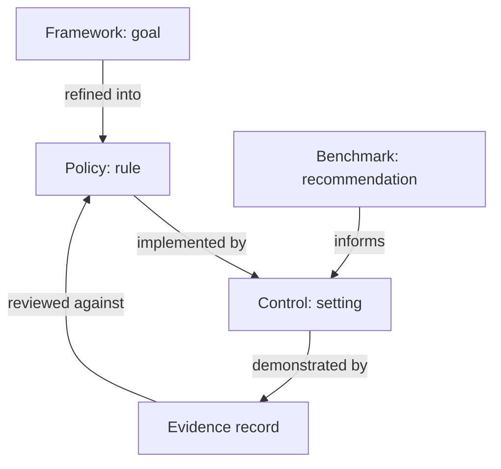

# Frameworks, Benchmarks, Policies And Evidence

A team runs a report service in the `starfleet` namespace. A customer asks the team to show that the service follows defined security requirements. The team has to answer with facts: which requirement, which setting in the cluster, and which record proves the setting. This part names the four kinds of document and record that appear in that answer, so that each question from an auditor can be matched to the right one.

Compliance means meeting the obligations that apply to a defined scope, and showing that you meet them. Security means reducing the real risk to assets. The two overlap, but they are not the same thing. A cluster can pass every check of a benchmark and still run an application that lets any user read another user's report.

## Four kinds of guidance and record

A **framework** organizes security goals, activities or controls. It tells an organization what to cover, and usually not how to configure one product. The National Institute of Standards and Technology (NIST) Cybersecurity Framework groups its work into the functions Govern, Identify, Protect, Detect, Respond and Recover. None of these functions is one Kubernetes setting. "Protect" covers access control, data security and platform hardening across the whole organization.

A **standard with certification** sets requirements that an organization can be audited against. ISO/IEC 27001 (International Organization for Standardization and International Electrotechnical Commission) describes the requirements for an information security management system, which is the set of processes an organization uses to manage security. The Payment Card Industry Data Security Standard (PCI DSS) sets requirements for environments that store, process or send payment card data. Both are about the organization and its environment, and a Kubernetes cluster is only one part of what an auditor looks at.

A **benchmark** is a detailed list of configuration recommendations for one technology and one version. The Center for Internet Security (CIS) publishes the CIS Kubernetes Benchmark. A recommendation in it is specific, for example that the API server must not allow anonymous requests, or that Secrets must not be readable by every service account. A benchmark does not say which of these matter for your organization. It says what a hardened setting looks like.

A **policy** is the organization's own written rule, such as "administrative access is limited to named people". An **evidence record** is the proof that a control implements the policy: a command result, a configuration export, an access review or a log entry. These four fit together as a chain, shown below.

The diagram shows that a benchmark informs a control but does not replace the policy, and that evidence is always judged against the rule it is meant to prove.

## One requirement followed to evidence

Take one goal from a framework: limit administrative access. The policy turns it into a rule: only the platform team may hold the `cluster-admin` role. A technical control implements the rule. In Kubernetes, the role-based access control (RBAC) system decides which identity may call which API action, and a `ClusterRoleBinding` is the object that gives an identity a role in every namespace.

The CIS Kubernetes Benchmark has a recommendation for exactly this control. It states that the `cluster-admin` role should only be used where required. The evidence that the control works is a list of every binding to `cluster-admin` together with the identities it names. A second kind of evidence is an access review, in which an owner confirms that each listed identity still needs the role.

Each piece of evidence answers a different question. The binding list shows what is configured at the time of the check. The access review shows that a person decided the grants were still needed. Neither one shows that nobody misused the role. That question needs audit logs, which belong to a different control.

## What a benchmark recommendation contains

A CIS recommendation has a fixed shape. It has an identifier, a description, a rationale that explains the risk, an audit procedure that says how to check the setting, and a remediation that says how to fix it. The audit procedure is what makes a recommendation usable as evidence, because two people who run it on the same cluster should get the same answer.

Each recommendation is either **automated** or **manual**. An automated recommendation can be decided by a program, for example the permission bits of a file or a flag of the API server process. A manual recommendation needs a person to judge the result, for example whether a Kubernetes cluster has network policies that fit the traffic of its applications. A tool can only list the facts for a manual recommendation, so the final decision stays with a person.

The Kubernetes benchmark is divided by the component it checks. Its first section covers the control plane node configuration and the API server, the controller manager and the scheduler. Its second section covers etcd, the key-value database that stores all cluster state. A further section covers the worker node and the kubelet, which is the agent that starts the containers on each node. The last section covers policies: RBAC, pod security, network policies and secrets handling, which are objects inside the cluster that its users create.

## Who owns which kind of check

The split by component also splits the ownership. On a cluster that you run yourself, one team owns every section. On a managed cluster, the provider owns the control plane files and processes, and the customer owns the policy objects in the cluster. A customer cannot run an audit procedure that reads files of a control plane the customer cannot log in to.

This is why the same benchmark recommendation can produce evidence from different parties. For a managed control plane, the evidence is the provider's own assurance report. For the policy section, the evidence is whatever the customer collects from the Kubernetes API. An assessment that mixes the two without saying so gives a wrong picture of who proved what.

## Why more than one framework applies

An organization often has several requirements at the same time: a contract with a customer, a national law and an internal standard. Each one uses its own words. Many of them ask for the same underlying control, so one technical control can serve several requirements. A list of every binding to `cluster-admin` is evidence for an access control requirement in a framework, a standard and a benchmark at the same time.

The reverse is also true. A single requirement can need several technical controls, and some of them are not technical at all, for example an onboarding process that removes access when a person leaves. A compliance record therefore keeps a mapping from the requirement to the controls and from each control to its evidence. When the mapping is missing, nobody can tell which evidence to renew when a requirement changes.

## Who checks the evidence

A control is only useful when somebody other than its author can confirm it. This section explains the three usual ways to check, because each one changes how much the result can be trusted.

Evidence has a reader. The same control can be checked in three ways, and each way gives a different level of trust. In a **self-assessment**, the team that runs the cluster checks its own settings. This is fast and cheap, and it finds most configuration mistakes, but the checker and the owner are the same people.

In an **internal audit**, a person from another team in the same organization repeats the checks. In an **external audit**, an independent auditor checks the controls against a named standard and writes a report. The auditor does not trust a summary. The auditor asks to see the original output, the time it was collected, and the identity of the person who collected it.

This is why a good evidence record carries more than the result. It says what was checked, on which cluster, at what time, with which command or tool version, and by whom. A screenshot with no date and no cluster name proves very little, because the auditor cannot tell whether it shows the cluster in production or a test cluster from last year.

## A small mapping for the example service

The table below shows how one framework goal maps to a policy, a benchmark area, a control in the `starfleet` namespace and its evidence. It is a short reference list, so it stays dense.

| Goal | Policy | Control | Evidence |
| --- | --- | --- | --- |
| Limit administrative access | Only named people hold `cluster-admin` | No `ClusterRoleBinding` to `cluster-admin` for the `shuttle` service account | List of bindings with subjects |
| Run workloads with least privilege | No privileged containers | `probe` runs with `privileged: false` | List of privileged pods per namespace |
| Limit credential exposure | Pods get an API token only when they call the API | `automountServiceAccountToken: false` on pods that do not call the API | List of pods that mount a token volume |

The three rows use the same pattern: a rule in words, a setting that can be read, and a record of what was read. A control that has no readable setting, such as a rule that only people follow, needs a different kind of evidence, for example a signed review.

Each row is checked by reading objects from the Kubernetes API, so each check can be repeated at any time and by any person who has read access. The next two parts show how to collect these facts and how to record them.

You now know the four kinds of material and how one goal becomes evidence. What is still open is how far an assessment reaches, who is responsible for each part of it, and how long its result stays true. Those questions come next.

## Common pitfalls

> [!WARNING]
> A framework, a certifiable standard and a configuration benchmark have different scopes. A passed Kubernetes benchmark does not establish an organization's complete obligation, and a framework does not tell you which setting to change. Evidence is only useful when it names the requirement it supports.
