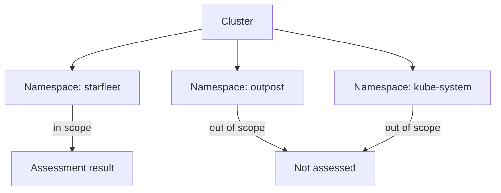

# Scope, Versions And Shared Responsibility

An assessor looks at the Kubernetes cluster of a company and reports that no privileged containers were found. A week later, a second assessor looks at the same cluster and finds several. Neither person made a mistake. The first one checked the `starfleet` namespace. The second one checked every namespace, including `kube-system`. The two results answer different questions, and only the stated scope tells the reader which question each one answers.

This part explains the three things that bound every compliance result: the scope, the versions and the time of the check. It also explains who is responsible for each part of the scope.

## Assessment scope

The **scope** of an assessment is the list of systems, components, namespaces and processes that the assessment covers. A result is only a statement about that scope. Everything outside it is not assessed, which is different from being compliant.

Scope can be drawn along several lines. One line is the cluster itself: which clusters, which node groups. Another line is the namespace: the `starfleet` namespace holds the example application, and the `outpost` namespace holds a client of another team. A third line is the type of object: pods, role bindings, network policies. A fourth is the layer: the application code, the container image, the cluster configuration, the node operating system and the cloud account.

Here is a concrete case. The `starfleet` namespace has three workloads: `scout`, `probe` and `shuttle`. Suppose the assessment scope is "the `starfleet` namespace". The `kube-proxy` pods of the `kube-system` namespace run privileged containers on a standard cluster. That finding is real, but it is not part of the scope, so it does not fail a check of the `starfleet` namespace. Equally, a clean result for `starfleet` says nothing about `kube-system`.

The diagram shows that the scope decides which parts of the cluster contribute to the result. Objects outside the scope are not assessed, so a clean result says nothing about them.

## A scope statement

A good scope statement is short and precise. It names the cluster, the namespaces, the object kinds and what is excluded. For the example, it could read: "Cluster `starfleet-prod`, namespace `starfleet`, all pods and role bindings, excluding system namespaces". Anyone who reads this line knows what a later result covers.

Scope also has a reason. Teams narrow the scope because they can only prove what they control. A team that owns only the `starfleet` namespace cannot give evidence about the nodes, and it cannot change the settings of other namespaces. Narrowing the scope to what the team owns makes the result honest. Narrowing it to hide known failures does not, and an auditor will ask why a namespace is missing.

## Versions

A benchmark is written for one version of the technology. The CIS Kubernetes Benchmark has a numbered release, and a release is mapped to a range of Kubernetes versions. A check that was correct for an older Kubernetes version can be wrong for a newer one. For example, a flag of the API server can be removed in a later release, and a check for that flag then passes or fails for the wrong reason.

Three versions matter for a record. The first is the version of the benchmark that was used. The second is the version of the Kubernetes cluster that was assessed, which `kubectl version` reports. The third is the version of the tool that ran the checks, if a tool was used. A record that lacks these cannot be repeated, and a reader cannot tell whether a later difference comes from the cluster or from the checker.

## Time

A cluster changes. A new role binding, a new Deployment or a node upgrade can turn a passing check into a failing one in seconds. A result is therefore only true at the time of the observation. A record needs a timestamp, and it is best written in Coordinated Universal Time (UTC), for example `2026-11-03T10:15:00Z`, so that readers in different time zones read it the same way.

Time also limits how long a result is useful. An auditor who reads a record that is eleven months old learns what was true eleven months ago. Many frameworks ask for evidence from a recent period, and some ask for evidence of a control working over a whole period, which needs repeated checks and not a single one. A common practice is to run the checks on a schedule and keep every result.

## Shared responsibility

Different parties run different layers, and each party is responsible for the layer it runs. On a cluster operated by a cloud provider, the provider usually runs the control plane. The control plane is the set of components that decide what runs in the cluster: the API server, the scheduler, the controller manager and etcd. The customer runs the workloads, the role bindings, the network policies and the image choices.

On a cluster that a team builds itself, such as a kind cluster or a kubeadm cluster, one team runs every layer. It is then responsible for every section of the benchmark. The same recommendation about the API server can therefore belong to the provider in one organization and to the platform team in another.

An assessment needs a table that says who is responsible for each part. Without it, two failures can happen. A customer can assume that the provider covers a setting that the customer actually owns. Or a customer can claim a provider setting as its own evidence, and an auditor then asks for a proof that the customer cannot produce.

## Dependencies

Scope also has edges that touch things outside the cluster. This section covers what a team depends on and does not own.

A workload depends on things it does not own: the container image, the base operating system, a database service and a cloud network. A compliance statement about the workload does not automatically cover these. If a requirement covers them, the record must either include them in the scope or point to a statement from the party that owns them.

A statement from another party is evidence too, but it has its own scope and date. For example, a provider's report may cover its services for a given period and a given list of regions. A customer that runs in another region is not covered by that report. The reader of the record must check these limits in the same way as for a team's own checks.

## Responsibility for the example cluster

The table below shows one possible split for a managed cluster and for a self-built cluster. It is a reference list, so it stays short.

| Layer | Managed cluster | Self-built cluster |
| --- | --- | --- |
| API server, scheduler, etcd | Provider | Platform team |
| Node operating system and kubelet | Provider or platform team, by contract | Platform team |
| Role bindings and Pod Security labels | Customer | Platform team |
| Pod specifications of `starfleet` | Application team | Application team |

The last row never moves. The team that writes the `probe` Deployment decides whether its container is privileged, whatever platform it runs on.

## Exceptions

Not every failed check can be fixed at once. This section explains how a team records a known gap without hiding it.

Sometimes a control cannot be met. A node agent may need a privileged container, or a legacy job may need a broad role. A compliance record then keeps an **exception**: a written decision to accept a known gap for a limited time. An exception names four things: the reason, the owner who accepts the risk, the exact scope of the object it covers, and a date on which it is reviewed.

An exception is not a way to turn a failure into a pass. The check still fails, and the record says so next to the exception. A reader can then see which gaps exist, who accepted them and when they expire. An exception with no owner and no review date is just a failure that nobody tracks.

You now know what bounds a result: the scope, the versions, the time and the owner of each layer. The remaining question is how to collect such evidence from a real cluster in a way that anyone can repeat.

## Common pitfalls

> [!WARNING]
> A result without a scope, a version and a time is not evidence. Do not extend a clean result from one namespace to the whole cluster, do not reuse an old record as proof of the present, and do not claim a provider setting as your own control without a statement from the provider.
