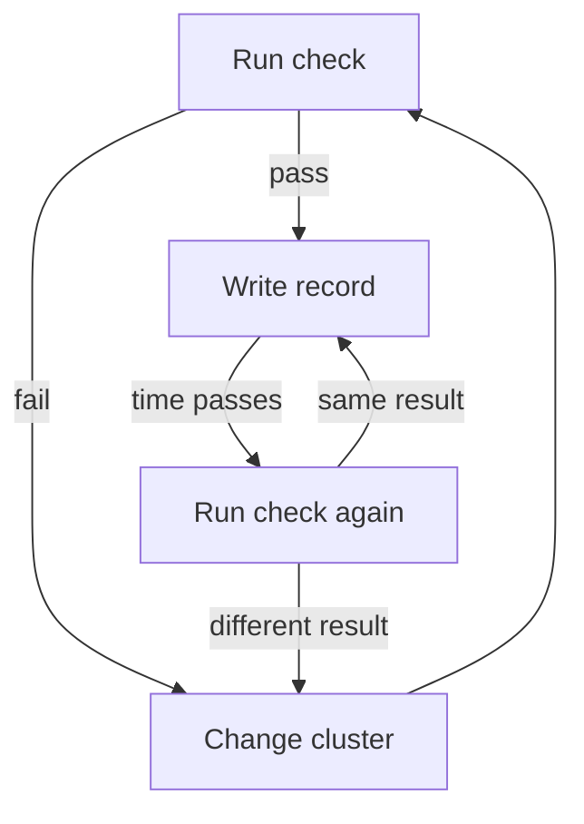

# Collecting Control Evidence With kubectl

A control is only as good as the proof that it works. In the `starfleet` namespace, three settings are in question: who holds `cluster-admin`, which pods mount a service account token, and which pods run a privileged container. The Kubernetes API holds the answer to each one. This part collects that evidence with `kubectl`, changes the cluster, collects it again and records the result.

The commands below use `jq`, a command-line program that reads and filters JSON. `kubectl get -o json` prints an object as JSON, and `jq` selects the fields that matter. The playground has `kubectl` pointed at the cluster as the cluster administrator.

<!-- astrona:playground:renew -->

Start with the helpers. A shell function gives each check a name, so that you run the same command each time. The playground overview lists the same three functions. Save this as `evidence-helpers.sh`:

```sh
cluster_admin_bindings() {
  kubectl get clusterrolebindings,rolebindings -A -o json | jq -r '.items[] | select(.roleRef.name=="cluster-admin") | .kind + " " + .metadata.name + " -> " + ([.subjects[]? | .kind + ":" + (.namespace // "") + "/" + .name] | join(", "))'
}
token_mounts() {
  kubectl -n "$1" get pods -o json | jq -r '.items[] | .metadata.name + " token-volumes=" + ([.spec.volumes[]? | select(.name | startswith("kube-api-access"))] | length | tostring)'
}
privileged_pods() {
  kubectl -n "$1" get pods -o json | jq -r '.items[] | select(any(.spec.containers[]; .securityContext.privileged == true)) | .metadata.name'
}
```

Load it into the current shell:

```sh
source evidence-helpers.sh
```

## Control: who holds cluster-admin

The control says that the `cluster-admin` role is only bound where required. The `cluster-admin` role allows every action on every resource. A `ClusterRoleBinding` gives the role to its subjects in all namespaces, and a `RoleBinding` that points at the `cluster-admin` role gives the same rights inside one namespace.

The function reads both kinds of binding in all namespaces and keeps those whose `roleRef.name` is `cluster-admin`. Run it:

```sh
cluster_admin_bindings
```

The output has one line per binding with its subjects. A fresh kind cluster contains built-in bindings to `cluster-admin`, for example one for the group `system:masters`, and kind adds one for the group `kubeadm:cluster-admins`. Those are part of the cluster setup. The line that matters for the example is the `shuttle-admin` binding, which names the service account `shuttle` in `starfleet`. The `shuttle` pod does not call the Kubernetes API, so it has no need for this role.

To check the effect and not only the object, ask the API server what the service account may do:

```sh
kubectl auth can-i '*' '*' --as=system:serviceaccount:starfleet:shuttle
```

The answer is `yes`. The binding list shows the configuration, and `kubectl auth can-i` shows the result of all rules together. Both are useful evidence, and an auditor who reads the second one does not need to understand the role binding objects.

## Control: service account tokens

By default, Kubernetes mounts a service account token into every pod. The kubelet, the agent on the node, writes the token into a projected volume whose name starts with `kube-api-access`. A process in the pod can use the token to call the API server with the rights of the service account. A pod that does not call the API gains nothing from the token, and an attacker who takes over the pod gains a credential.

Count the token volumes of each pod:

```sh
token_mounts starfleet
```

Each line shows a pod name and `token-volumes=1`. To remove the token, set `automountServiceAccountToken: false` in the pod template of the Deployment. Save this as `scout-no-token.yaml`:

```yaml
spec:
  template:
    spec:
      automountServiceAccountToken: false
```

Apply it as a patch:

```sh
kubectl -n starfleet patch deployment scout --patch-file scout-no-token.yaml
kubectl -n starfleet rollout status deployment scout
```

The patch changes the pod template, so the Deployment controller creates a new pod and removes the old one. Run `token_mounts starfleet` again. The new `scout` pod now shows `token-volumes=0`, while the other pods are unchanged. This is the point of repeating a check: the second run proves that the change reached the running pod, and not only the Deployment object.

## Control: privileged containers

A container with `privileged: true` runs with almost all the capabilities of the node and can see its devices. A process that escapes such a container controls the node. The benchmark recommends that the cluster minimizes the admission of such containers. Run the check for the example namespace:

```sh
privileged_pods starfleet
```

The output lists the `probe` pod. The same function with `kube-system` as its argument lists the `kube-proxy` pod on a standard cluster, which is outside the scope of this check. That difference is the reason the record must name its scope.

## Recording the evidence

Commands in a terminal disappear when the terminal closes. A record keeps them. A ConfigMap is a Kubernetes object that stores plain key and value data, so it can hold a small record next to the workloads. First read the version of the cluster, because the record must contain it:

```sh
kubectl version -o json | jq -r '.serverVersion.gitVersion'
```

Save this as `control-evidence.yaml`. Replace `<VERSION>` with the value that the command printed, and `<TIME>` with the current time in UTC in the form `2026-11-03T10:15:00Z`:

```yaml
apiVersion: v1
kind: ConfigMap
metadata:
  name: control-evidence
  namespace: starfleet
data:
  scope: "namespace starfleet, workloads scout, probe and shuttle"
  kubernetes-version: "<VERSION>"
  observed-at: "<TIME>"
  "5.1.1": "PASS no binding to cluster-admin names a service account of starfleet"
  "5.1.6": "PASS no pod of starfleet has a kube-api-access volume"
  "5.2.2": "PASS no pod of starfleet has a privileged container"
```

Write a `PASS` line only after the matching check shows it. Apply the record:

```sh
kubectl apply -f control-evidence.yaml
```

The record is only true for the moment named in `observed-at`. If someone adds a new privileged Deployment tomorrow, the record does not change by itself, and it becomes wrong without any warning. A later check must run the same commands again and replace the record.



The diagram shows that the record follows the checks. A passing result produces a record, and every later check either confirms the record or sends the work back to a change.

You now know how to read three controls from the Kubernetes API, how to confirm that a change reached the running pod and how to keep the result in a record with its scope, version and time. What the record cannot do is show that the application is safe, because it only describes what was checked.

## Common pitfalls

> [!WARNING]
> Do not write `PASS` before you have seen the output that proves it, and do not copy a record from an earlier run. Check the running pods and not only the Deployment, because a pod that started before the change keeps the old settings. Name the scope in the record, because a clean result for one namespace says nothing about another one.
