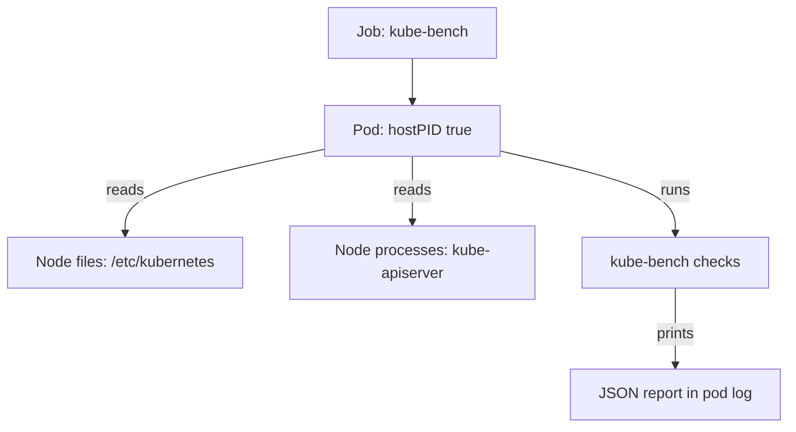

# How kube-bench Reads A Cluster

A platform team has to answer one question for a customer: does our cluster follow the CIS Kubernetes Benchmark? The benchmark has more than a hundred recommendations. Many of them ask about a command-line flag of the API server or the permission bits of a file on the node. Nobody wants to read those by hand on every node. This part explains how the tool kube-bench automates the audit procedures of the benchmark, and what the tool needs in order to see the cluster.

kube-bench is an open source program that runs the audit procedures of the Center for Internet Security (CIS) Kubernetes Benchmark and prints a result for each recommendation. It does not change the cluster. It reads files and processes, runs the commands that the benchmark lists as audit procedures, and compares the output with the expected value.

## What a check does

Each recommendation in kube-bench is one **check**. A check has an identifier such as `1.2.1`, a description, an audit command, a test and a remediation text. For example, check `1.2.1` asks that the API server runs with `--anonymous-auth=false` and is not given a value that allows anonymous requests. The audit command looks at the command line of the running `kube-apiserver` process. The test then compares the flags it found with the expected value.

This means that kube-bench works on the node where the component runs and not through the Kubernetes API. It reads the process list, the static pod manifests under `/etc/kubernetes/manifests`, the kubelet configuration file and file permissions. A tool that only talks to the API server could not see most of this.

## Targets

The benchmark is split into sections by component. kube-bench calls each section a **target**, and a run can select one or more of them with `--targets`.

| Target | Section | What it checks |
| --- | --- | --- |
| `master` | 1 | Control plane node files, API server, controller manager, scheduler |
| `etcd` | 2 | The etcd database that holds the cluster state |
| `controlplane` | 3 | Authentication and logging settings that are read from the cluster |
| `node` | 4 | Worker node files and the kubelet |
| `policies` | 5 | RBAC, pod security, network policies, secrets and other objects |

A target is only meaningful on the right machine. The `master` and `etcd` targets read files that exist on a control plane node. The `node` target reads the kubelet files that exist on every node. On a single-node kind cluster, the one node is both the control plane and a worker, so all of them find their files on the same machine.

## The benchmark version

kube-bench holds one configuration directory for each benchmark release. The version `v0.16.0` of kube-bench ships the configuration `cis-2.0`, and it maps Kubernetes 1.34 and 1.35 to that configuration. kube-bench detects the Kubernetes version and picks the matching benchmark by itself. The `--benchmark cis-2.0` flag sets it explicitly, so that a later kube-bench release cannot change the checks under you without a visible change in your command.

This matters for the evidence record of an audit. The result belongs to the pair of the cluster version and the benchmark version. If either one changes, the same check can mean something different.

## Why the pod needs host access

kube-bench runs inside a container, but the things it must read are on the node. Three settings give it that view.

First, `hostPID: true` puts the pod in the process namespace of the node. The checks for the API server and the kubelet look for the running process and its flags, and a pod in its own process namespace cannot see them.

Second, read-only `hostPath` volumes mount the node directories that the checks read, such as `/etc/kubernetes`, `/var/lib/kubelet` and `/var/lib/etcd`. The `readOnly: true` setting keeps the audit from changing the files it reads.

Third, the directory `/usr/bin` of the node is mounted at `/usr/local/mount-from-host/bin`. The image contains its own tools, and the mount lets kube-bench run the binaries that the node uses, for example `kubelet`, to read their version and flags.



The diagram shows that the pod reads the node's files and processes, runs the checks and writes the report to its log. The Kubernetes API server is not the source of those facts.

## Where the pod runs

The Job must run on the control plane node for the `master` and `etcd` targets. A control plane node carries the taint `node-role.kubernetes.io/control-plane:NoSchedule`. A taint is a mark on a node that keeps pods away unless the pod has a matching toleration. The Job therefore needs two things: a `nodeSelector` on the label `node-role.kubernetes.io/control-plane` so that the scheduler picks that node, and a toleration for the taint so that the scheduler may place the pod there.

On a managed cluster, the control plane nodes are not visible to the customer. A Job cannot be scheduled there, and the `master` and `etcd` targets cannot run. The customer can still run the `node` and `policies` targets, and the provider reports on the rest.

<!-- astrona:playground:renew -->

Run kube-bench as a Job in the `compliance` namespace. The Job below runs the four targets with the benchmark `cis-2.0` and asks for JSON output. Save this as `job-kube-bench.yaml`:

```yaml
apiVersion: batch/v1
kind: Job
metadata:
  name: kube-bench
  namespace: compliance
spec:
  backoffLimit: 0
  template:
    metadata:
      labels:
        app: kube-bench
    spec:
      hostPID: true
      restartPolicy: Never
      nodeSelector:
        node-role.kubernetes.io/control-plane: ""
      tolerations:
        - key: node-role.kubernetes.io/control-plane
          operator: Exists
          effect: NoSchedule
      containers:
        - name: kube-bench
          image: docker.io/aquasec/kube-bench:v0.16.0
          command: ["kube-bench", "run", "--targets", "master,node,etcd,policies", "--benchmark", "cis-2.0", "--json"]
          volumeMounts:
            - {name: var-lib-etcd, mountPath: /var/lib/etcd, readOnly: true}
            - {name: var-lib-kubelet, mountPath: /var/lib/kubelet, readOnly: true}
            - {name: var-lib-kube-scheduler, mountPath: /var/lib/kube-scheduler, readOnly: true}
            - {name: var-lib-kube-controller-manager, mountPath: /var/lib/kube-controller-manager, readOnly: true}
            - {name: etc-systemd, mountPath: /etc/systemd, readOnly: true}
            - {name: lib-systemd, mountPath: /lib/systemd/, readOnly: true}
            - {name: srv-kubernetes, mountPath: /srv/kubernetes/, readOnly: true}
            - {name: etc-kubernetes, mountPath: /etc/kubernetes, readOnly: true}
            - {name: usr-bin, mountPath: /usr/local/mount-from-host/bin, readOnly: true}
            - {name: etc-cni-netd, mountPath: /etc/cni/net.d/, readOnly: true}
            - {name: opt-cni-bin, mountPath: /opt/cni/bin/, readOnly: true}
      volumes:
        - {name: var-lib-etcd, hostPath: {path: /var/lib/etcd}}
        - {name: var-lib-kubelet, hostPath: {path: /var/lib/kubelet}}
        - {name: var-lib-kube-scheduler, hostPath: {path: /var/lib/kube-scheduler}}
        - {name: var-lib-kube-controller-manager, hostPath: {path: /var/lib/kube-controller-manager}}
        - {name: etc-systemd, hostPath: {path: /etc/systemd}}
        - {name: lib-systemd, hostPath: {path: /lib/systemd}}
        - {name: srv-kubernetes, hostPath: {path: /srv/kubernetes}}
        - {name: etc-kubernetes, hostPath: {path: /etc/kubernetes}}
        - {name: usr-bin, hostPath: {path: /usr/bin}}
        - {name: etc-cni-netd, hostPath: {path: /etc/cni/net.d/}}
        - {name: opt-cni-bin, hostPath: {path: /opt/cni/bin/}}
```

Apply it:

```sh
kubectl apply -f job-kube-bench.yaml
```

Wait until the Job finishes:

```sh
kubectl -n compliance wait --for=condition=complete job/kube-bench --timeout=300s
```

The Job controller creates one pod, and the pod runs the checks and exits. A Job that completes has a pod with the status `Completed`, and its log holds the report. If the wait times out, run `kubectl -n compliance describe pod -l app=kube-bench` and read the events. A common reason is a host path that the pod may not mount, or a node that the selector does not match.

## Why the Job needs a namespace without enforcement

The pod uses `hostPID` and host paths, so it is not a restricted pod. Pod Security admission, the built-in controller that enforces the Pod Security Standards by namespace label, would reject it in a namespace that enforces the `baseline` or `restricted` level. The playground namespace `compliance` carries no such label, so the Job is admitted. On a real cluster, the team puts the audit Job in a dedicated namespace and limits who may create pods there.

You now know what kube-bench reads, why its pod needs host access and where it must run. The next question is what the report says and how to read a finding without mistaking it for a verdict.

## Common pitfalls

> [!WARNING]
> kube-bench reads the node it runs on. A Job that lands on a worker node cannot audit the control plane files, and a run on a managed cluster cannot see the provider's control plane at all. Never run the audit Job in a namespace that other teams share, because its pod has host process access and a read view of the node files.
