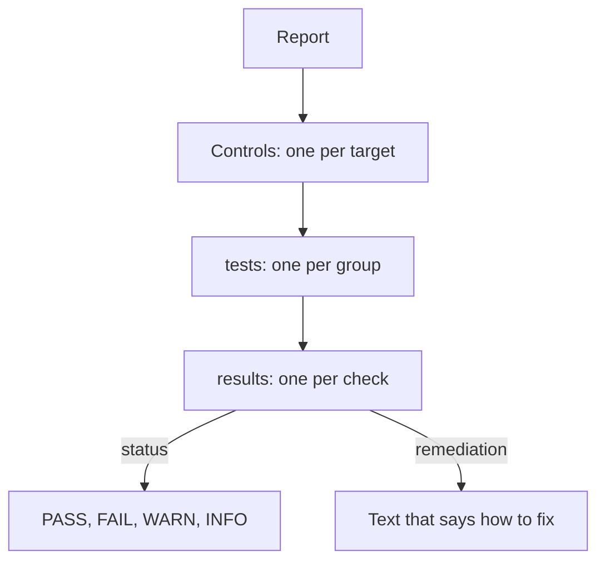

# Reading kube-bench Results

A kube-bench Job has finished, and its log holds a long report. A first reader sees hundreds of lines and a few dozen `FAIL` entries, and has to decide what they mean. Some failures are real weaknesses. Some are checks that kube-bench cannot decide. Some belong to a component that the team does not run. This part explains the four statuses, the structure of the JSON report and how to pull the failed checks out of it.

## The four statuses

Every check ends with one of four statuses.

- `PASS`: the audit command ran and the output matched the expected value.
- `FAIL`: the audit command ran and the output did not match the expected value.
- `WARN`: kube-bench cannot decide. The check is manual, or the audit needs information that the tool cannot read.
- `INFO`: the check is informational, or it was skipped on request.

The difference between `FAIL` and `WARN` matters most. A `FAIL` is a statement: kube-bench looked and found a setting that does not meet the recommendation. A `WARN` is no statement at all. It says that a person must decide, and the report only lists the recommendation.

The whole `policies` target shows this. Every recommendation in that section of the benchmark is manual, for example whether RBAC is used with the least privilege and whether network policies fit the traffic. kube-bench therefore reports `WARN` for all of them. A report with zero `FAIL` entries in the policies section does not mean that the cluster follows them. It means that the tool did not decide.

## The shape of the report

With `--json`, kube-bench prints one JSON document. The top level has a `Controls` array, with one element for each target. Each element has the fields `id`, `version`, `text` and `node_type`, which names the target, and the totals `total_pass`, `total_fail`, `total_warn` and `total_info`. It also has a `tests` array with one element for each group of checks, such as `1.2 API Server`. Each group has an array `results` with one object for each check.



The diagram shows that the status and the remediation text sit on the individual check, and the totals sit on the target.

A check object holds the fields `test_number`, `test_desc`, `audit`, `type`, `remediation`, `status`, `actual_value`, `expected_result` and `scored`. The `test_number` is the benchmark identifier, so it is the field to use in a record. The `remediation` is the text of the benchmark that says how to fix the finding. The `scored` field says whether the check counts towards a score, because the benchmark splits its recommendations into scored and not scored.

<!-- astrona:playground:renew -->

Read the totals first. The first helper prints the report from the first line that starts with `{`, because the log of a Job can hold other lines before the report. Paste it into your terminal:

```sh
bench_log() {
  kubectl -n compliance logs job/kube-bench | sed -n '/^{/,$p'
}
```

Now print one line for each target:

```sh
bench_log | jq -r '.Controls[] | .node_type + " pass=" + (.total_pass|tostring) + " fail=" + (.total_fail|tostring) + " warn=" + (.total_warn|tostring) + " info=" + (.total_info|tostring)'
```

The output has one line for each target that ran. Read the `policies` line carefully: its `pass` and `fail` values are expected to be zero, because all of its checks are manual. If this does not match what you see, the log may hold an error message and not a report, and you should look at the first lines of the log.

List the identifier of every failed check, with its target:

```sh
bench_log | jq -r '.Controls[] | .node_type as $target | .tests[]?.results[]? | select(.status == "FAIL") | $target + " " + .test_number'
```

The `.tests[]?` and `.results[]?` forms use the `?` operator. Some groups in the report have no results, and the operator skips them instead of ending the program with an error. This is the reason a copied command that omits the `?` can fail on a report that is otherwise fine.

## Reading one finding

Pick one identifier from the output, for example one from the `master` target, and print its whole object. Replace `<ID>` with the identifier you chose:

```sh
bench_log | jq --arg id '<ID>' '.Controls[].tests[]?.results[]? | select(.test_number == $id) | {test_number, test_desc, status, scored, remediation}'
```

The `remediation` text is written for a cluster that runs the control plane as static pods, which are pods that the kubelet starts from files in `/etc/kubernetes/manifests`. The fix is usually a flag change in one of those files. The kubelet watches the directory, so it restarts the component after the file changes. On a managed cluster, the provider owns those files, and the customer cannot apply the fix.

## Deciding what a finding means

A finding is a question to answer and not a verdict. Four questions sort most of them.

1. Is the component in scope, and who owns it? A finding about the API server is for the owner of the control plane.
2. Does the benchmark recommendation apply to this cluster? Some checks assume a setup that a given distribution does not use. A kind cluster, for example, is built for learning and testing, and several findings come from its defaults.
3. Is there a reason to accept the risk? This leads to an exception with an owner and a date.
4. If not, who fixes it, and how is the fix tested before it reaches a running control plane?

Treat a `FAIL` on a kind cluster with care. The report describes a real file or flag, but the fix may not be what you want on a throwaway cluster. The point of the exercise is to read the result and the reasoning, and not to push the failure count to zero.

You now know how to read the statuses and the structure of the report, and how to list findings. What is left is how to keep the result for an auditor and how to record a failure that cannot be fixed.

## Common pitfalls

> [!WARNING]
> A `WARN` is not a pass. Do not report the manual checks of the policies section as compliant, and do not count them in a pass rate. Do not copy a `jq` command that omits the `?` on `tests[]` and `results[]`, because a group without results can end it with an error. Do not fix a `FAIL` on a running control plane before you know which file the remediation changes.
