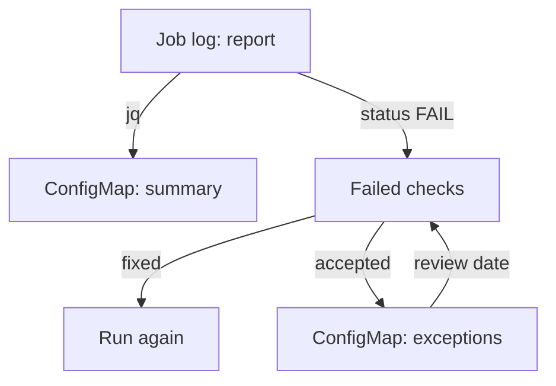

# Recording And Excepting Findings

An auditor will not read a 1 MiB JSON report. The auditor wants to know three things: what was checked, what failed and what the team decided to do about each failure. The raw report answers the first question, and a short record answers the other two. This part builds that record from the log of the Job, stores it in the cluster and writes down the failures that the team accepts.

Two rules guide the record. It must be built from the real report with a program, because a summary typed by hand can drift from the facts. And it must stay small, because a ConfigMap, the Kubernetes object that stores small configuration data, is limited to 1 MiB, and a full kube-bench report with the remediation text of every check can be large.

## What the record contains

A good record keeps the totals and the list of failed checks for each target. The totals show how big the audit was. The failed list shows what needs a decision. The remediation text can be looked up again in the benchmark, so the record does not copy it.

The jq program below builds one object for each target. It selects `node_type` and the four totals, and collects the `test_number` of every check with the status `FAIL`:

```text
[.Controls[] | {node_type, total_pass, total_fail, total_warn, total_info,
  failed: [.tests[]?.results[]? | select(.status == "FAIL") | .test_number]}]
```

The result is a JSON array. The `failed` list is empty for a target without failures, and not `null`, because the `?` operator and the array brackets produce an empty array.

<!-- astrona:playground:renew -->

Run the program against the log of the Job and keep the result in a file. First make sure the report is available. Paste the helper if your terminal does not have it:

```sh
bench_log() {
  kubectl -n compliance logs job/kube-bench | sed -n '/^{/,$p'
}
```

Build the summary:

```sh
bench_log | jq -c '[.Controls[] | {node_type, total_pass, total_fail, total_warn, total_info, failed: [.tests[]?.results[]? | select(.status == "FAIL") | .test_number]}]' > summary.json
```

Check that it is valid and small:

```sh
jq 'length' summary.json
wc -c summary.json
```

The first command prints the number of targets, which is the number you ran. The second prints the size in bytes, which should be a few kilobytes. Store the file in a ConfigMap. The command `kubectl create configmap --from-file` reads the file and uses its name as the key:

```sh
kubectl -n compliance create configmap kube-bench-summary --from-file=summary.json
```

The record now lives next to the Job. Anyone who can read ConfigMaps in `compliance` can read the summary, and anyone who can still read the Job log can rebuild it and compare. That second check is what makes the record believable, because a reader does not have to trust that nobody edited the ConfigMap.

## Failures that the team cannot fix

Some failures need a change to a part of the cluster that the assessment owner does not control, for example the static pod files of the control plane on a managed service. Others come from a deliberate choice that the team accepts. The team records these as exceptions.

An exception has four parts. It names the check that failed, gives the reason, names an owner who accepts the risk, and sets a date on which the decision is reviewed. A short sentence per check is enough for a small record. Pick the identifier of a check that failed in your own report. Replace `<ID>` below, and write a reason that is true for that check. Save this as `kube-bench-exceptions.yaml`:

```yaml
apiVersion: v1
kind: ConfigMap
metadata:
  name: kube-bench-exceptions
  namespace: compliance
data:
  "<ID>": "Accepted by the platform owner. Needs a change to a control plane static pod file that this assessment does not own. Review on 2027-02-01."
```

Apply it:

```sh
kubectl apply -f kube-bench-exceptions.yaml
```

Never list a check that passed or that was not run. The record would then claim that a failure existed that no report shows. An auditor who compares the exceptions with the report can catch this in a minute.



The diagram shows that a failed check either leads to a fix and a new run, or to an exception that returns to review on its date.

## Narrowing and skipping on purpose

A full run produces many findings that belong to somebody else. kube-bench has flags to narrow a run, and each one changes what the report says.

- `--targets master,node` runs only those sections. The report has no entry for the other targets, so the record must state which targets were run.
- `--check 1.2.1,1.2.2` runs only the listed checks. This is useful to confirm one fix without a full run.
- `--skip 1.2.1` leaves a check out. The check appears with the status `INFO`, so a skip is visible in the report. It is not the same as a pass.
- `--noremediations` leaves the fix text out of the output, which makes the report smaller.
- `--exit-code 1` makes kube-bench exit with that code when a check fails, so a pipeline can stop on a failure.

A skip is a decision to not look. An exception is a decision to look, accept the failure and write it down. Use an exception for a failure you know about, because it keeps the failure in the report.

## Running the audit again

The record is true for the moment of the run. A repeat run after a change shows whether the change worked. Delete the Job, apply it again and rebuild the summary. Compare the two `failed` lists. A check that disappeared from the list was fixed, and a check that appeared is new and needs a decision. If two runs on an unchanged cluster differ, treat that as a sign that a check depends on something that moves, for example a process that was not running when kube-bench looked.

You now know how to turn a raw report into a small record, store it, check it against the log and write down the failures the team accepts. What the record cannot do is prove that the cluster is secure, because the benchmark covers configuration and not every attack.

## Common pitfalls

> [!WARNING]
> Never write the summary by hand, and never store the full report with the remediation text of every check in one ConfigMap, because the object limit is 1 MiB. Do not use `--skip` to hide a failure, because it removes the failure from the picture and leaves no reason. Do not list a check in the exceptions unless it failed in your report.
