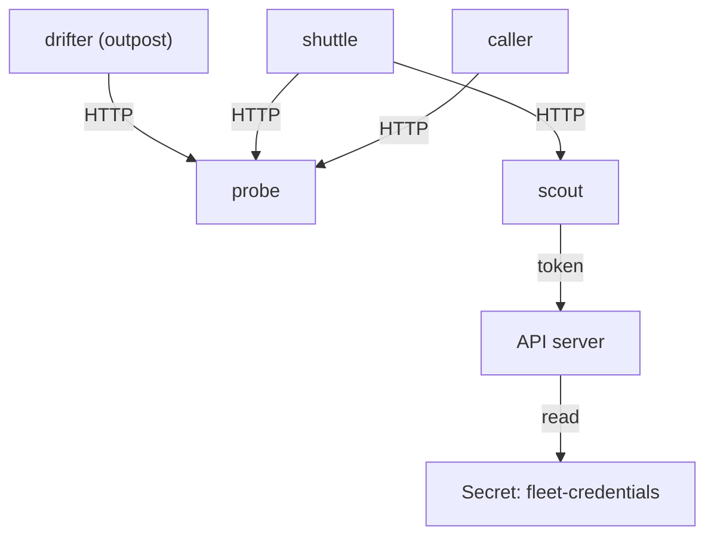

# Assets, Data Flows And Trust Boundaries

Security review often starts with a list of tools or a list of known vulnerabilities. A threat model starts earlier, with the system itself: what it holds, who talks to whom, and where the rules about who may do what change. If the description is wrong, every later answer is wrong too, so this part builds the description carefully from a running namespace.

## What a threat model is

A threat model is a structured answer to four questions. What are we building? What can go wrong? What are we going to do about it? Did we do a good enough job? The first question produces a system description. The second produces a list of threats. The third produces mitigations, which are the controls that reduce a threat. The fourth checks that the controls work and records the risk that remains.

A **threat** is a way that something bad could happen to an asset. A **vulnerability** is a weakness that makes a threat possible. A **mitigation** is a control that makes the threat harder or less harmful. **Risk** is the combination of how likely a threat is and how much harm it causes. A model that mixes these words gives answers that nobody can act on.

A **framework** is a fixed set of questions that the team reuses on every system. STRIDE is one such framework. It does not find threats by itself. It reminds the team which kinds of threats to look for, so the review does not depend on who happens to be in the room.

## Assets: what is worth protecting

An **asset** is anything whose loss, change or exposure would hurt the owner. In a Kubernetes application the assets are rarely the pods. They are the things that the pods hold or can do. Write each asset as a noun with the property that matters: the confidentiality of a credential, the integrity of a deployment, the availability of a service.

Start with what the namespace contains. Run this in the playground:

<!-- astrona:playground:renew -->

```sh
kubectl -n starfleet get deployments,services,serviceaccounts,configmaps,secrets
```

The output should list the Deployments `scout`, `probe`, `shuttle` and `caller`, the Services `scout` and `probe`, one service account per workload, the ConfigMap `scout-config` and the Secret `fleet-credentials`, plus the default objects of the namespace. The exact ages and counts differ on your cluster.

From this list you can write the assets. The Secret `fleet-credentials` is a confidential credential. The Deployment objects are assets whose integrity matters, because whoever can change a Deployment decides which code runs. The Service `probe` is an asset whose availability and whose data matter to its callers. The service accounts are assets too, because each one is an identity that the API server trusts.

## Data flows: how requests move

A **data flow** is one path along which data or authority moves from one element to another. A **data-flow diagram** shows the elements and the flows between them. The elements are of four kinds. An **external entity** sits outside the system and sends or receives data, for example a person or another team's pod. A **process** runs code. A **data store** holds data at rest. A **flow** is the arrow between two of them.

In Kubernetes the flows are real network connections and real API calls, so you can read them from the cluster. The `shuttle` and `caller` pods call the Service `probe` and the Service `scout`. The `drifter` pod belongs to another team and can call the same Services. Each pod also has a service account, and the pod can call the API server with it. That last flow is easy to forget because no manifest draws it.

The diagram below shows the flows of the playground application. Each arrow is a connection that exists in the cluster.



The diagram shows three clients that call `probe`, one client that calls `scout`, and the `scout` service account token, which lets a process in `scout` call the Kubernetes API server. The API server reads the Secret from etcd, the cluster database.

## Prove the flows instead of assuming them

A data-flow diagram that comes from memory is a hypothesis. Test each arrow with a real request. The `shuttle` pod has `curl`, so it can send a request to the Service `probe`:

```sh
kubectl -n starfleet exec deploy/shuttle -- curl -s -o /dev/null -w '%{http_code}\n' --max-time 4 http://probe.starfleet.svc/get
kubectl -n outpost exec deploy/drifter -- curl -s -o /dev/null -w '%{http_code}\n' --max-time 4 http://probe.starfleet.svc/get
```

Both commands should print `200`. The second one matters more: a pod from another team in another namespace reaches `probe`. No manifest allowed this on purpose. Kubernetes allows all pod-to-pod traffic until a NetworkPolicy selects the pods, so the flow exists by default. This is the first finding of the review, and you found it by testing the flow, not by reading YAML.

Do the same for identities. The API server decides what a service account may do, and `kubectl auth can-i` asks it:

```sh
kubectl auth can-i --list -n starfleet --as=system:serviceaccount:starfleet:scout
```

The list should be long. It includes rules for most namespaced resources, including Secrets, Deployments and pods, because the `edit` ClusterRole is bound to the account. This is the second finding: the `scout` application only serves HTTP, yet its identity can change the namespace.

## Trust boundaries: where the rules change

A **trust boundary** is a place where data or a request passes between two elements that have different levels of trust, different identities or different rights. A boundary matters because the receiving side must not assume that the sender is honest. Every threat in a data-flow diagram sits on a flow that crosses a trust boundary, or on an element that holds the authority to cross one.

Kubernetes has several boundaries, and they differ in strength:

- The **cluster edge** separates the network outside the cluster from the pods. The API server and any exposed Service sit on it.
- A **namespace** separates names and RBAC rules. It does not separate the network: with no NetworkPolicy, pods in different namespaces reach each other.
- A **pod** and its containers are separated from the node by the container runtime and the kernel. The `securityContext` decides how thin that separation is. A privileged container removes most of it.
- A **service account** is a boundary between a workload and the API server. The token in the pod is the key that crosses it.

In the diagram, mark where each flow crosses one. The flow from `drifter` to `probe` crosses a namespace. The flow from `scout` to the API server crosses the service account boundary. The `probe` container, being privileged, is only weakly separated from the node, so the node is one flow away from anything that gets code running in `probe`.

## Write the assumptions down

An **assumption** is a condition the model takes as true without checking it. Examples: the node is trusted, the container runtime isolates processes, the network plugin enforces NetworkPolicy, and only the platform team can change the Deployments. An assumption that nobody wrote down cannot be reviewed, and an unreviewed assumption is where an unexpected incident starts.

Check one assumption now. The model assumes that the network plugin enforces NetworkPolicy. A plugin that does not enforce policies accepts the objects without error and ignores them, so the assumption needs a real request later. You will test it in the next parts.

You now have the three things a model needs before any threat is named: a list of assets, a data-flow diagram that you tested against the cluster, and the boundaries and assumptions written next to it. The open question is what to ask at each flow, and STRIDE answers it.

## Common pitfalls

> [!WARNING]
> Drawing the diagram from the manifests only misses the flows that Kubernetes creates by default: pod-to-pod traffic across namespaces, and the call from every pod to the API server with its service account token. Test each arrow with a real request and a real `can-i` question. Also do not mark a namespace as a network boundary: it separates names and RBAC rules, but traffic crosses it freely until a NetworkPolicy exists.
