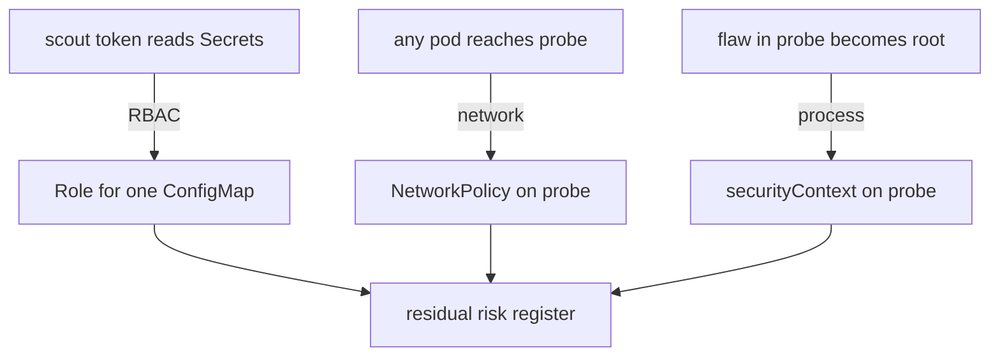

# Mitigations And Residual Risk

A threat list changes nothing in the cluster. This part turns each of the three threats into a control that the cluster enforces, proves each control with a request, and then records what each control leaves possible. That last step is what separates a threat model from a to-do list.

## From a threat to a control

A mitigation fits a threat when it breaks a specific step of the path, and the step is named by the flow and the boundary. Start from the entry in the threat list, name the step, and only then pick the Kubernetes feature.



The diagram shows each threat, the control that answers it and the register where the remaining risk is written down.

The three controls act at three different places. RBAC is enforced by the API server, so it limits what an identity may ask the API server to do. A NetworkPolicy is enforced by the network plugin on each node, so it limits which pods may connect. A `securityContext` is enforced by the container runtime and the kernel on the node, so it limits what a process may do on the node. A control at one place does not replace a control at another.

## Mitigation 1: least privilege for the scout identity

The elevation-of-privilege threat on `scout` comes from the grant, so the fix changes the grant. The application only needs to read the ConfigMap `scout-config`. A **Role** is a list of allowed actions in one namespace, and a **RoleBinding** gives a Role to a subject. A rule can name one object with `resourceNames`, which limits the right to that object.

Delete the broad binding first:

<!-- astrona:playground:renew -->

```sh
kubectl -n starfleet delete rolebinding scout-edit
```

Save this as `role-scout-config-reader.yaml`:

```yaml
apiVersion: rbac.authorization.k8s.io/v1
kind: Role
metadata:
  name: scout-config-reader
  namespace: starfleet
rules:
  - apiGroups: [""]
    resources: ["configmaps"]
    resourceNames: ["scout-config"]
    verbs: ["get"]
---
apiVersion: rbac.authorization.k8s.io/v1
kind: RoleBinding
metadata:
  name: scout-config-reader
  namespace: starfleet
subjects:
  - kind: ServiceAccount
    name: scout
    namespace: starfleet
roleRef:
  apiGroup: rbac.authorization.k8s.io
  kind: Role
  name: scout-config-reader
```

Apply it:

```sh
kubectl apply -f role-scout-config-reader.yaml
```

Then check the result. The first command should print `yes` and the second should print `no`:

```sh
kubectl auth can-i get configmaps/scout-config -n starfleet --as=system:serviceaccount:starfleet:scout
kubectl auth can-i get secrets -n starfleet --as=system:serviceaccount:starfleet:scout
```

The API server enforces the answer for every request that uses the token. The control removes the path from a flaw in `scout` to the Secret. It does not stop the flaw itself, and `scout` can still read its ConfigMap.

## Mitigation 2: a NetworkPolicy on probe

The disclosure threat comes from a flow that the cluster allows by default. A **NetworkPolicy** selects pods and lists the traffic they accept. As soon as one policy selects a pod for ingress, every connection that no policy allows is dropped. The policy below selects the `probe` pods and allows ingress only from pods labelled `app: shuttle` in the same namespace. The port is the container port of `probe` (`8080`), because a policy matches pod ports, not Service ports.

Save this as `networkpolicy-probe-allow-shuttle.yaml`:

```yaml
apiVersion: networking.k8s.io/v1
kind: NetworkPolicy
metadata:
  name: probe-allow-shuttle
  namespace: starfleet
spec:
  podSelector:
    matchLabels:
      app: probe
  policyTypes:
    - Ingress
  ingress:
    - from:
        - podSelector:
            matchLabels:
              app: shuttle
      ports:
        - protocol: TCP
          port: 8080
```

Apply it:

```sh
kubectl apply -f networkpolicy-probe-allow-shuttle.yaml
```

Then test all three callers. The network plugin enforces the policy, not the API server, so only a real request proves it. The first request should print `200`. The other two should print `000` after four seconds, because `curl` reports a failed connection that way:

```sh
kubectl -n starfleet exec deploy/shuttle -- curl -s -o /dev/null -w '%{http_code}\n' --max-time 4 http://probe.starfleet.svc/get
kubectl -n starfleet exec deploy/caller -- curl -s -o /dev/null -w '%{http_code}\n' --max-time 4 http://probe.starfleet.svc/get
kubectl -n outpost exec deploy/drifter -- curl -s -o /dev/null -w '%{http_code}\n' --max-time 4 http://probe.starfleet.svc/get
```

If all three print `200`, the plugin does not enforce policies and the earlier assumption in the model was wrong. That result is a finding, not a mistake in the test.

## Mitigation 3: a securityContext on probe

The third threat sits on the process boundary, so the control limits the process. Save this strategic merge patch as `patch-probe-securitycontext.yaml`. It changes only the `securityContext` of the container named `probe`. It removes `privileged`, drops every Linux capability, blocks privilege escalation through setuid programs, and sets a numeric non-root user. A numeric user is required because `runAsNonRoot` cannot check a user that the image names by words.

```yaml
spec:
  template:
    spec:
      containers:
        - name: probe
          securityContext:
            privileged: false
            runAsNonRoot: true
            runAsUser: 65534
            runAsGroup: 65534
            allowPrivilegeEscalation: false
            capabilities:
              drop: ["ALL"]
            seccompProfile:
              type: RuntimeDefault
```

Apply it and wait for the new pod:

```sh
kubectl -n starfleet patch deployment probe --patch-file patch-probe-securitycontext.yaml
kubectl -n starfleet rollout status deployment/probe
```

The change edits the pod template, so the Deployment controller starts a new pod and removes the old one. Always check the running pod, because a Deployment can show a new template while the old pod still runs. Read the effective settings of the running pod:

```sh
kubectl -n starfleet get pod -l app=probe -o jsonpath='{.items[0].spec.containers[0].securityContext}{"\n"}'
```

The output should show `"privileged":false`, `"runAsUser":65534` and `"allowPrivilegeEscalation":false`.

## Residual risk: what stays possible

**Residual risk** is the risk that remains after the controls are in place. Every control leaves some. Writing it down is not an admission of failure: it tells the next reader what the model still accepts, so nobody assumes more protection than exists.

For each control ask one question: what can an attacker still do on the same path? For the ConfigMap Role, a process in `scout` can still read `scout-config`, which is a small and known exposure. For the NetworkPolicy, a compromised `shuttle` can still call `probe`, because the policy trusts a pod label and not a verified identity, and the traffic is still plain HTTP. For the `securityContext`, an attacker with code execution in `probe` is now an unprivileged process, but a kernel flaw could still allow an escape.

Record each remaining risk with an owner and a decision. The decision is one of four: accept it, reduce it with another control, transfer it, or avoid it by changing the design. A residual risk with no owner is a threat that nobody watches.

## Keep the model current

A model is a description of a design, and the design changes. Update the model when a change adds or removes an element, a flow, a trust boundary or an identity. For example, a new external database adds a data store and a flow that crosses the cluster edge, so STRIDE runs again on that flow. A new service account with a broad role adds an identity that needs its own entry.

Retest the assumptions at the same time. If the cluster moves to a network plugin that does not enforce NetworkPolicy, the second control no longer works, even though the YAML is unchanged. The model, the controls and the checks must change together, because a diagram that no longer matches the cluster gives false confidence.

You now have a full pass: assets, flows and boundaries, STRIDE threats, controls that the cluster enforces and a record of what remains. The model becomes useful when someone repeats the pass after each change.

## Common pitfalls

> [!WARNING]
> A NetworkPolicy object that the network plugin ignores looks identical to one that works, so always test with a real request. Do not claim a threat is closed because a control exists: name what the control prevents and what stays possible. Also, `runAsNonRoot: true` without a numeric `runAsUser` stops pods whose image uses a named user.
