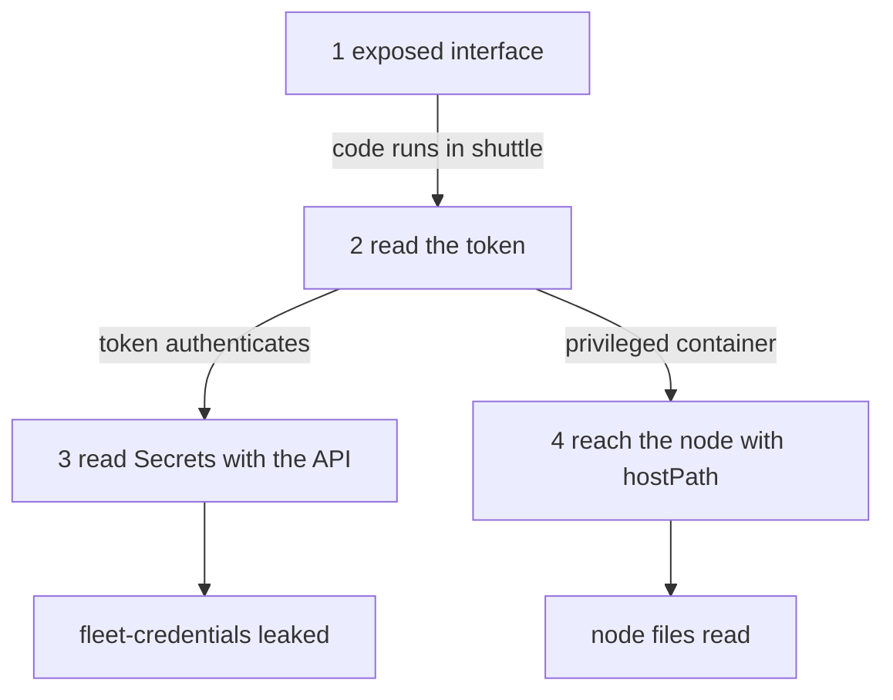

# Following An Attack Path

A single weakness is rarely the whole story. An attack path is the chain of steps that takes an attacker from the first foothold to the asset, and every step needs the one before it. If you can write the chain down, you can find the cheapest link to cut. This part follows one chain in the playground from the entry point to the node.

## The path in one picture

An **attack path** is an ordered list of steps. Each step uses one technique, gives the attacker something new, and enables the next step. The path in this module has five steps.



The diagram shows that stealing the token leads to two separate outcomes: the Secret through the API server, and the node through the container. Both outcomes start from code running in `shuttle`.

The first step, the exposed interface, is how the foothold appears. This module starts after that step: the `shuttle` pod already runs the attacker's command, and the commands below use `kubectl exec` to stand in for it.

## Step 1: an exposed interface gives the foothold

An attacker needs somewhere to run code first. The common entries are an application with a remote code execution flaw, an exposed Kubernetes Dashboard or other management interface without authentication, an API server that accepts anonymous requests or whose credentials leaked, and an exposed kubelet API. In ATT&CK terms these are Exploit Public-Facing Application and External Remote Services.

The **API server** is the component that serves the Kubernetes API, and every request to the cluster goes through it. The **kubelet** is the agent on each node that starts the containers. A **dashboard** is a web interface that sends API requests with the rights of its own service account or of the logged-in user. A dashboard whose service account has `cluster-admin` and that anyone can reach gives the visitor `cluster-admin`.

Defenders cut this step by keeping the interfaces private, by requiring authentication, and by giving the interface identity the smallest possible rights. The playground cannot show every entry, so the next steps use `shuttle` as the foothold.

## Step 2: the service account token

Kubernetes places a **service account token** in every pod by default. It is a signed credential, a JSON Web Token (JWT), that proves the pod's identity to the API server. The kubelet writes it to a file at `/var/run/secrets/kubernetes.io/serviceaccount/token`, beside the cluster certificate authority file `ca.crt` and a file `namespace`. Since Kubernetes 1.22 the token is bound to the pod and expires, and the kubelet refreshes it. A token that is stolen from a running pod works while the pod exists, and it stops working when the pod is deleted or when it expires.

Anyone who can run a command in the container can read the file. List the directory as the attacker would:

<!-- astrona:playground:renew -->

```sh
kubectl -n starfleet exec deploy/shuttle -- ls /var/run/secrets/kubernetes.io/serviceaccount
```

The output should list three entries: `ca.crt`, `namespace` and `token`. This is the technique Steal Application Access Token. The attacker needs no exploit for it, because the token exists to be read by the application. The only question is what the token is allowed to do.

## Step 3: use the token against the API

The API server is reachable inside every pod at the name `kubernetes.default.svc`. A request to it with the token in an `Authorization: Bearer` header is authenticated as the service account. The API server then checks RBAC for the identity `system:serviceaccount:starfleet:shuttle`, so the result depends only on the grants.

The next command acts as the attacker. It reads the token, sends it to the API server and asks for the Secret `fleet-credentials`. The `sh -c` runs inside the pod, so the single quotes keep your own shell from expanding the variables:

```sh
kubectl -n starfleet exec deploy/shuttle -- sh -c 'curl -s --cacert /var/run/secrets/kubernetes.io/serviceaccount/ca.crt -H "Authorization: Bearer $(cat /var/run/secrets/kubernetes.io/serviceaccount/token)" https://kubernetes.default.svc/api/v1/namespaces/starfleet/secrets/fleet-credentials'
```

The response should be a JSON object of kind `Secret`. Its `data` field holds the values in base64, which is an encoding and not encryption, so the attacker decodes them without a key. This is Unsecured Credentials through the container API. The Role `shuttle-secret-reader` made it possible. Nothing in the application needed that right.

The same request with a service account that has no grant gets a `403 Forbidden` response with a JSON body that names the identity, the verb and the resource. That response is what the next part produces.

## Step 4: a privileged container reaches the node

The `shuttle` container is privileged and mounts the node directory `/var/log` at `/host-logs`. A **privileged container** has nearly all Linux capabilities and access to the devices of the node. A **hostPath volume** mounts a file or directory of the node into the container. Together they remove most of the isolation between the process and the node. Check what the container sees:

```sh
kubectl -n starfleet exec deploy/shuttle -- ls /host-logs
```

The output should list log files and directories of the node. In this playground the mounted path is only a log directory, so the exposure is small. In a real cluster the path may be `/`, the container runtime socket or the kubelet directory, and writing there lets an attacker run code on the node. That is Escape to Host.

Read the user too:

```sh
kubectl -n starfleet exec deploy/shuttle -- id
```

The output should show `uid=0(root)`. The process is root inside a container that is privileged. Root in a normal container is limited by dropped capabilities and by the user namespace of the runtime. Root in a privileged container is not.

## Why the chain matters

Look at what each step gave the attacker. Step 2 gave an identity, step 3 turned the identity into data, and step 4 turned the process into a node-level foothold. The steps used four ordinary features: a token that Kubernetes mounts by default, a Role that was too wide, a privileged flag and a hostPath volume.

This is also why a list of single findings can mislead. A scanner that reports "privileged container" and "Secret read right" as two medium findings does not show that together they connect an exposed interface to the node. The path shows the order and the dependency, so the defender can decide where one change removes the most.

You have now walked the path from the foothold to the Secret and to the node. The open question is which links to cut, and how to prove they are cut.

## Common pitfalls

> [!WARNING]
> Do not read the attack path as a prediction that every cluster is open at the first step. The path starts with a foothold that the attacker must obtain, and the defence is strongest where the foothold is hard to get. Also do not treat a base64 value in a Secret as protected: it is encoded, not encrypted, and anyone who can read the Secret can decode it.
