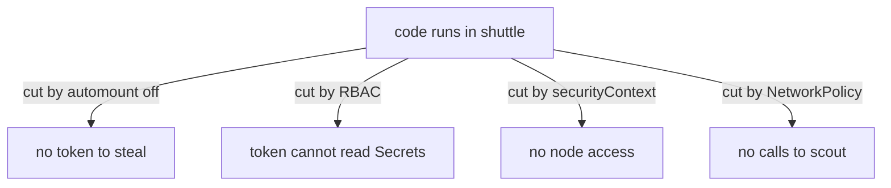

# Breaking The Path

A path is only as strong as its weakest link, and one control on one link is enough to stop that path. Several controls on several links are better, because an attacker who finds a way around one still meets the next. This part cuts the path of the previous steps in four places and repeats the same attack after each cut, so you see each control work.

## Which control breaks which step

Match every step to the feature that Kubernetes provides for it. The four controls act at different places, so none of them replaces another.



The diagram shows four cuts that all start from the same foothold. Each cut removes one thing the attacker could do with it.

RBAC limits what the identity may do at the API server. The `automountServiceAccountToken` setting decides whether the token exists in the pod at all. The `securityContext` limits what the process may do on the node. A NetworkPolicy limits which pods the process may reach. The order below starts with RBAC because it is the cheapest to prove and the least likely to break the application.

## Cut 1: remove the Secret access

The attack in the previous part read a Secret because a Role allowed it. A Role cannot grant rights that nobody asked for, so the fix is to delete the Role and its RoleBinding. The `shuttle` application never calls the API, so it needs no replacement. Delete both objects:

<!-- astrona:playground:renew -->

```sh
kubectl -n starfleet delete rolebinding shuttle-secret-reader
kubectl -n starfleet delete role shuttle-secret-reader
```

Repeat the attack request from inside `shuttle`. The token still exists, so the API server still authenticates the identity. The result should change from the Secret object to a `Forbidden` response that names `system:serviceaccount:starfleet:shuttle` and the verb `get` on `secrets`:

```sh
kubectl -n starfleet exec deploy/shuttle -- sh -c 'curl -s --cacert /var/run/secrets/kubernetes.io/serviceaccount/ca.crt -H "Authorization: Bearer $(cat /var/run/secrets/kubernetes.io/serviceaccount/token)" https://kubernetes.default.svc/api/v1/namespaces/starfleet/secrets/fleet-credentials'
```

The attacker is authenticated but has no rights. Authentication and authorization are separate checks, which is why a valid token with no rights still gets a refusal. The Secret path is cut. The token still exists, and it still works for any right that a role gives to every authenticated identity, so the next cut removes the token.

## Cut 2: do not mount the token

A workload that never calls the API does not need a token. The field `automountServiceAccountToken` controls whether Kubernetes mounts the token. It can be set on the service account or in the pod spec. The pod value wins when both are set. With `false`, the kubelet does not create the token volume, so there is nothing to read.

The same patch will also fix the securityContext in Cut 3, because both are changes to the pod template, and one patch rolls out one new pod. Save this strategic merge patch as `patch-shuttle-hardening.yaml`. The `$patch: delete` lines remove the hostPath volume and its mount from the lists:

```yaml
spec:
  template:
    spec:
      automountServiceAccountToken: false
      volumes:
        - name: node-logs
          $patch: delete
      containers:
        - name: shuttle
          volumeMounts:
            - name: node-logs
              $patch: delete
          securityContext:
            privileged: false
            runAsNonRoot: true
            runAsUser: 10001
            runAsGroup: 10001
            allowPrivilegeEscalation: false
            capabilities:
              drop: ["ALL"]
            seccompProfile:
              type: RuntimeDefault
```

Apply it and wait for the new pod:

```sh
kubectl -n starfleet patch deployment shuttle --patch-file patch-shuttle-hardening.yaml
kubectl -n starfleet rollout status deployment/shuttle
```

Now repeat the listing of the token directory. The command should fail with a message that the directory does not exist, because the new pod has no token volume:

```sh
kubectl -n starfleet exec deploy/shuttle -- ls /var/run/secrets/kubernetes.io/serviceaccount
```

A failed command is the expected result here. The attack step Steal Application Access Token has nothing to steal, and the earlier RBAC change becomes a second layer instead of the only one.

## Cut 3: take away the node access

The same patch also removed the privileged flag, the hostPath volume and root. Check the three results. The first command should fail because the mount is gone. The second should print a non-zero user ID, `10001`:

```sh
kubectl -n starfleet exec deploy/shuttle -- ls /host-logs
kubectl -n starfleet exec deploy/shuttle -- id -u
```

The settings do different jobs. `privileged: false` removes access to the devices of the node. Dropping `ALL` capabilities removes the Linux rights that a root process would otherwise keep. `allowPrivilegeEscalation: false` stops a process from gaining more rights than its parent through a setuid program. `runAsNonRoot: true` with a numeric `runAsUser` makes the kubelet refuse to start the container as root. `seccompProfile: RuntimeDefault` filters dangerous system calls. Removing the hostPath volume removes the part of the node that was visible.

The container is still a process on a shared kernel. A kernel flaw can still allow an escape, so the control lowers the chance and the impact without making them zero.

## Cut 4: limit where shuttle can connect

An attacker who cannot read Secrets or reach the node can still use the foothold to scan and call other pods. This is Network Service Discovery and Lateral Movement. A NetworkPolicy of type Egress selects pods and lists where they may send traffic. As soon as a policy selects a pod for egress, all other outgoing connections of that pod are dropped, including DNS lookups unless you allow them.

The policy below lets the `shuttle` pods send traffic to the `probe` pods on port `8080` and to the cluster DNS pods on port 53 in `kube-system`. The DNS rule is needed so the name `probe` still resolves. Save this as `networkpolicy-shuttle-egress.yaml`:

```yaml
apiVersion: networking.k8s.io/v1
kind: NetworkPolicy
metadata:
  name: shuttle-egress
  namespace: starfleet
spec:
  podSelector:
    matchLabels:
      app: shuttle
  policyTypes:
    - Egress
  egress:
    - to:
        - podSelector:
            matchLabels:
              app: probe
      ports:
        - protocol: TCP
          port: 8080
    - to:
        - namespaceSelector:
            matchLabels:
              kubernetes.io/metadata.name: kube-system
          podSelector:
            matchLabels:
              k8s-app: kube-dns
      ports:
        - protocol: UDP
          port: 53
        - protocol: TCP
          port: 53
```

Apply it:

```sh
kubectl apply -f networkpolicy-shuttle-egress.yaml
```

Then test both directions. The first request should print `200`. The second should print `000` after four seconds, because the policy drops the connection to `scout`:

```sh
kubectl -n starfleet exec deploy/shuttle -- curl -s -o /dev/null -w '%{http_code}\n' --max-time 4 http://probe.starfleet.svc/get
kubectl -n starfleet exec deploy/shuttle -- curl -s -o /dev/null -w '%{http_code}\n' --max-time 4 http://scout.starfleet.svc/
```

The network plugin enforces the policy, so the request is the proof. If both requests print `200`, the plugin ignores the policy.

## What remains

After the four cuts, the attacker still has code execution in `shuttle`. The path to the Secret, to the node and to `scout` is cut, and the path to `probe` stays, because `shuttle` needs it. That is residual risk and belongs in the threat model.

Controls also fail separately. A mistake in the RBAC change does not matter if the token is not mounted, and a kernel flaw does not matter for the Secret if the identity has no right. This is the reason to cut several links of the same path: each cut must hold only for its own step.

You now know the order of an attack path, the controls that break each step and how to prove a cut with the same request the attacker would send.

## Common pitfalls

> [!WARNING]
> Deleting a RoleBinding does not remove the token, and removing the token does not change the rights of the service account. Test every cut with the request that the attacker would send, and check the running pod, not only the Deployment. A NetworkPolicy with `policyTypes: Egress` and no DNS rule makes names stop resolving, and the failure looks like a broken application.
