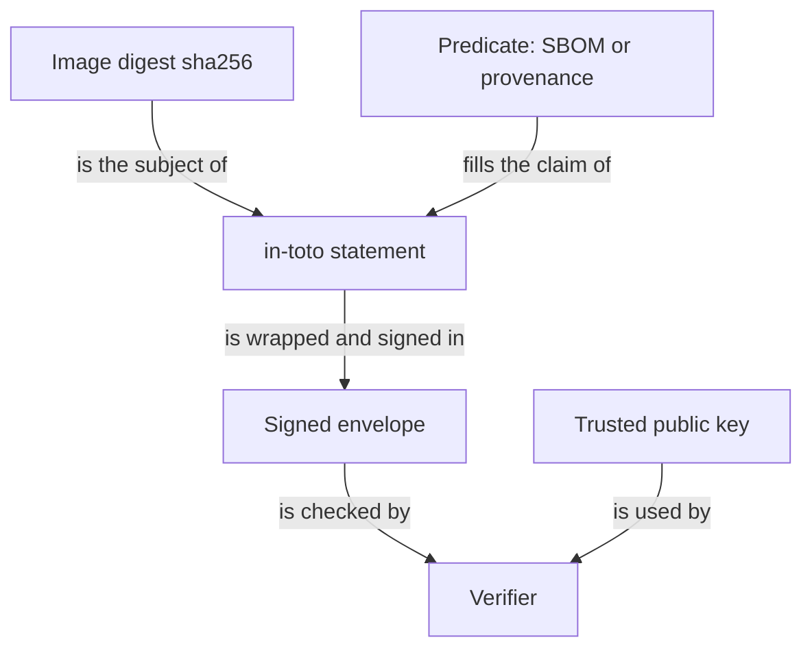

# SBOM Formats And Provenance

The platform team has the digest of `scout`. Next it asks two more questions. What is inside that image? And where did it come from? A new vulnerability in a popular library is announced on a Tuesday, and the team has to know by lunch which deployed images contain that library. Without an inventory, the only way to find out is to open every image.

Two kinds of record answer these questions. An inventory of components answers the first and is called an SBOM. A statement about origin answers the second and is called provenance. This part shows both, and shows how an in-toto attestation wraps either of them into something a program can verify.

## What an SBOM contains

A software bill of materials (SBOM) is a machine-readable list of the components that make up an artifact. For a container image the components are operating system packages, language libraries, and sometimes the application itself. Each entry has a name and a version, and usually a package URL (purl), a standard string such as `pkg:golang/example.com/lib@1.2.3` that identifies a package across tools.

An SBOM answers "is library X in this artifact?". It does not answer "is library X exploitable here?" or "is this artifact safe?". It is an inventory, and its value is that you can search it without opening the image.

Two formats are common.

**SPDX** (Software Package Data Exchange) is a Linux Foundation standard and an ISO standard. In JSON form, the top level has `spdxVersion`, `name`, a list of `packages` and a list of `relationships`. A relationship says that one element describes, contains or depends on another. SPDX began with licence compliance, and it records licence information in detail.

**CycloneDX** is an OWASP standard that began with application security. In JSON form, the top level has `bomFormat`, `specVersion`, a list of `components` and a list of `dependencies`. It has first-class fields for vulnerabilities and for services.

Both formats can describe the same image. They differ in structure and in the details they stress, so counts of "packages" and "components" for one image can differ. Choose the format that your consumers accept. Many teams produce both.

## Try it: create both SBOMs for one digest

This exercise uses the digest of the `scout` pod. Define the helper and read the digest:

<!-- astrona:playground:renew -->

```sh
tb() { kubectl -n supply-chain exec toolbox -- "$@"; }
IMAGE_ID=$(kubectl -n starfleet get pod -l app=scout -o jsonpath='{.items[0].status.containerStatuses[0].imageID}')
DIGEST=${IMAGE_ID##*@}
```

Create an SPDX JSON SBOM of that exact digest. Trivy pulls the image by digest and lists what it finds. The first run downloads data and can take a minute:

```sh
tb mkdir -p /work/sbom
tb trivy image --format spdx-json --output /work/sbom/scout.spdx.json "ghcr.io/stefanprodan/podinfo@$DIGEST"
```

Create a CycloneDX SBOM of the same digest:

```sh
tb trivy image --format cyclonedx --output /work/sbom/scout.cdx.json "ghcr.io/stefanprodan/podinfo@$DIGEST"
```

Then compare the two top levels with `jq`:

```sh
tb sh -c 'jq "{spdxVersion, name, packages: (.packages | length)}" /work/sbom/scout.spdx.json'
tb sh -c 'jq "{bomFormat, specVersion, components: (.components | length)}" /work/sbom/scout.cdx.json'
```

The first command prints the SPDX version, the document name and a package count. The second prints `CycloneDX`, the specification version and a component count. The two counts are close but not necessarily equal, because the formats model the image differently.

## Provenance: where the artifact came from

**Provenance** is a record of how an artifact was produced. It names the artifact by digest and then states the facts of the build: which build platform ran it, which build type and parameters it used, which source revision and dependencies it consumed, and when it started and finished.

An SBOM and provenance are different documents. The SBOM looks inside the artifact. Provenance looks at the process that made it. A reviewer who has only the SBOM knows the components but cannot tell whether the image was built by the release pipeline or by a laptop. A reviewer who has only the provenance knows the pipeline but cannot search the components.

## SLSA levels describe the build, not the code

SLSA defines a build track with levels that describe how much you can rely on the provenance:

| Level | What it requires of the build | What it tells a consumer |
| --- | --- | --- |
| Build L1 | The build produces provenance | Someone documented the build; the record could be wrong or forged |
| Build L2 | A hosted build platform generates and signs the provenance | The platform, not the project, vouches for the record |
| Build L3 | The platform isolates builds and protects the signing key from the build steps | A build step cannot forge the provenance of another build |

A higher level means the provenance is harder to forge. It never means the software has fewer bugs. A level-3 build of vulnerable code produces vulnerable software with reliable provenance.

## in-toto attestations wrap the claim

An **attestation** is a signed statement about an artifact. The in-toto project defines a common shape. A statement holds three things: a **subject** (the artifact name and its digest), a **predicate type** (a URI that says what kind of claim follows) and the **predicate** (the claim itself). The statement travels inside a signed envelope, so a verifier can check who made it.



The statement ties the claim to one digest, and the envelope ties the statement to one signer.

The same envelope can carry an SPDX SBOM, a CycloneDX SBOM, SLSA provenance or a scan result. Only the predicate type changes. A verifier that knows which predicate types it needs can reject an artifact that has a signed statement of the wrong kind.

## What an SBOM and a scan do not prove

The scan of an SBOM looks each listed component up in a vulnerability database and prints matches. Two limits follow.

First, the result depends on the database on the day of the scan. The same SBOM scanned a month later can show new findings, because new vulnerabilities were published.

Second, the result depends on the SBOM. If the SBOM misses a component, the scan cannot find its problems. A statically compiled binary that hides its dependencies is a typical case.

## Common pitfalls

> [!WARNING]
> Do not treat an SBOM as a safety statement. It lists components. A clean scan of a complete SBOM means no known issue was matched on that day, nothing more.

> [!WARNING]
> Do not read a SLSA level as a quality grade for the code. The level describes how reliable the build record is. Check the track, the level and the version of the specification that the record claims.
