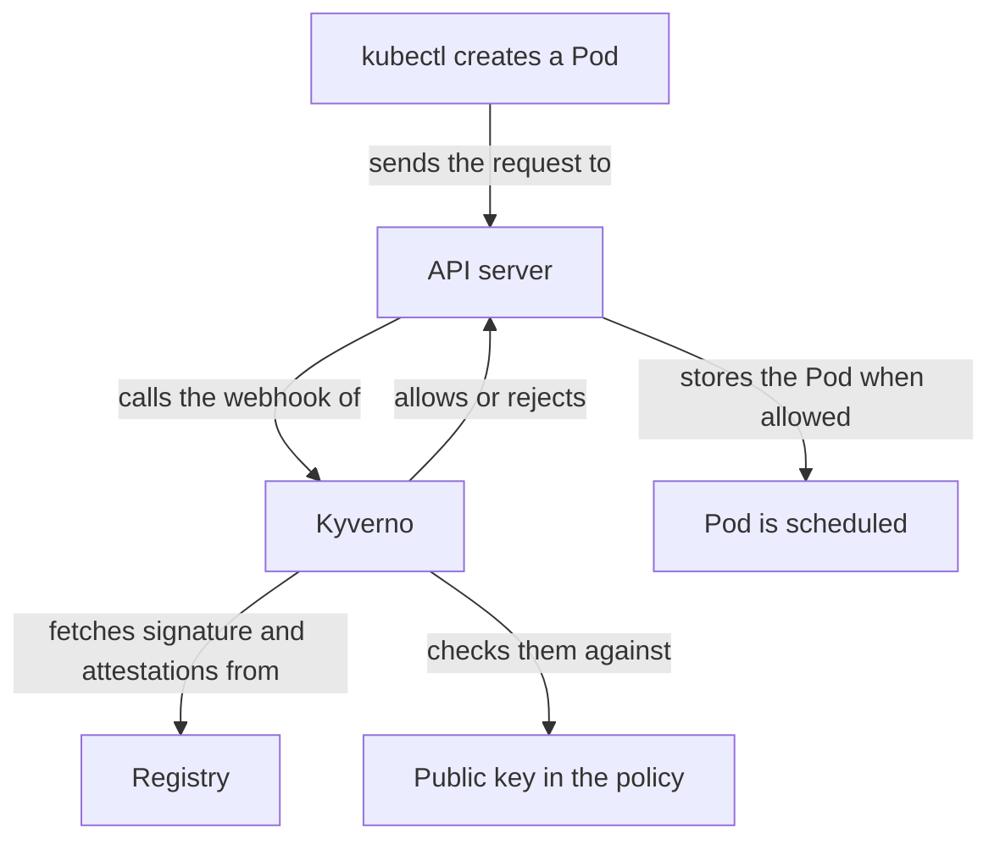

# The Kyverno Verification Gate

The scout image is signed and carries an SBOM. Nothing yet forces anyone to use only such images. A developer can still run `kubectl run` with the unsigned drifter image, and the cluster starts it. The platform team wants the cluster itself to refuse images without a valid signature. That is a job for an admission controller.

## Where the gate sits

When someone creates a pod, the Kubernetes API server authenticates and authorizes the request, then calls **admission webhooks**: programs that can change or reject the object before it is stored. Kyverno registers webhooks for this purpose and evaluates policies written as Kubernetes resources.

For image verification, Kyverno reads each image reference in the pod, asks the registry for the signature of that image, checks it against the keys in the policy, and either allows the pod or rejects it with a message.



Kyverno decides before the pod exists, so a rejected image never reaches a node.

## The shape of a verification rule

A `ClusterPolicy` holds rules. A rule that verifies images uses `verifyImages`. These are the fields that matter:

| Field | What it does |
| --- | --- |
| `imageReferences` | Patterns of the images the entry applies to. An image that matches none is not checked. |
| `failureAction` | `Enforce` rejects the pod. `Audit` allows it and records the failure. |
| `attestors` | Who may sign. Each entry holds a public key, or a keyless identity. |
| `attestations` | Predicate types that must be present and valid, with their own attestors. |
| `mutateDigest` | Replaces the tag in the pod with the verified digest. |
| `verifyDigest` | Requires that the image reference has a digest. |
| `required` | Requires a signature. When false, an image with no signature passes. |

A single `verifyImages` entry verifies signatures or attestations, not both. A policy that needs both uses two rules, one for each.

Two details come from the test setup. `rekor.ignoreTlog: true` tells Kyverno not to look for a transparency log entry, which matches signing with `--tlog-upload=false`. The `imageReferences` pattern uses the registry address, so the rule applies to images from the cluster registry only.

## Try it: refuse unsigned images

<!-- astrona:playground:renew -->

This exercise needs a key pair in `/work/keys` and a signed scout digest. If the playground is fresh, create both with the commands below. Skip them when you already have both:

```sh
kubectl -n supply-chain exec toolbox -- sh -c 'mkdir -p /work/keys && cd /work/keys && cosign generate-key-pair'
kubectl -n supply-chain exec toolbox -- sh -c 'cd /work/keys && cosign sign --yes --key cosign.key --tlog-upload=false --allow-insecure-registry --allow-http-registry "$REGISTRY/starfleet/scout@$(image-digest starfleet/scout 6.15.0)"'
```

The flag `--tlog-upload=false` skips the transparency log, and the two registry flags allow the plain-HTTP test registry. Print the public key, because you paste it into the policy:

```sh
kubectl -n supply-chain exec toolbox -- cat /work/keys/cosign.pub
```

The command prints three lines: a `BEGIN PUBLIC KEY` line, one line of key text and an `END PUBLIC KEY` line. Save this as `clusterpolicy-require-signed-images.yaml`. Replace `<your key lines>` with the three lines you printed and keep the indentation:

```yaml
apiVersion: kyverno.io/v1
kind: ClusterPolicy
metadata:
  name: require-signed-images
spec:
  webhookConfiguration:
    failurePolicy: Fail
    timeoutSeconds: 30
  background: false
  rules:
    - name: verify-signature
      match:
        any:
          - resources:
              kinds: ["Pod"]
      verifyImages:
        - imageReferences:
            - "registry.supply-chain.svc.cluster.local:5000/*"
          failureAction: Enforce
          mutateDigest: true
          verifyDigest: true
          required: true
          attestors:
            - count: 1
              entries:
                - keys:
                    publicKeys: |-
                      <your key lines>
                    rekor:
                      ignoreTlog: true
                      url: https://rekor.sigstore.dev
                    ctlog:
                      ignoreSCT: true
```

Apply it:

```sh
kubectl apply -f clusterpolicy-require-signed-images.yaml
```

Kubernetes prints a deprecation warning for `kyverno.io/v1`. Ignore it. Then check that the policy is ready:

```sh
kubectl get clusterpolicy require-signed-images
```

The `READY` column shows `True` after a few seconds. Kyverno needs that time to register its webhook with the new policy.

Now try to start a pod from the unsigned drifter image. The flag `--dry-run=server` sends the request through admission and stores nothing:

```sh
kubectl -n outpost run unsigned-test --image=registry.supply-chain.svc.cluster.local:5000/outpost/drifter:2.25.0 --dry-run=server
```

Kubernetes refuses the request. The error message names the policy `require-signed-images` and says that the image verification failed. Now try the signed scout image:

```sh
kubectl -n starfleet run signed-test --image=registry.supply-chain.svc.cluster.local:5000/starfleet/scout:6.15.0 --dry-run=server
```

The command prints `pod/signed-test created (server dry run)`. The pod uses a tag, and Kyverno verified the digest behind it. Because of `mutateDigest: true`, the stored pod would carry the digest instead of the tag, so a later change to the tag cannot change what runs.

An image from another registry, such as `ghcr.io/stefanprodan/podinfo:6.15.0`, is not checked at all, because the `imageReferences` pattern does not match it.

## Requiring the SBOM too

To demand an SBOM attestation as well, add a second rule to the policy. The rule uses the `attestations` field with the type `https://spdx.dev/Document` and its own attestors with the public key. Leave out the attestors and any attestation of that type passes, whoever signed it. A pod needs both rules to pass, so the image must be signed and must carry a verified SPDX statement.

## What the gate does not do

The gate checks pods at creation. It does not stop a pod that is already running, and it does not re-check later. It verifies what the policy matches, so a pod in a namespace or from a registry that the rules skip is unchecked. It does not look inside the image. A signed image with a vulnerable library passes.

Two settings change the effective control. With `failurePolicy: Fail`, pod creation fails when Kyverno is unreachable, which is strict. With `Ignore`, an outage admits everything. Kyverno also caches successful verifications for a short time, so a revoked signature can stay accepted until the cache entry expires.

## Common pitfalls

> [!WARNING]
> Do not set `failureAction: Audit` and call it a gate. Audit records a failure and admits the pod. Use `Enforce` when the policy must refuse.

> [!WARNING]
> An `imageReferences` pattern that is too broad blocks system images that nobody signed, and one that is too narrow leaves images unchecked. Test both an image that must pass and an image that must fail.

> [!WARNING]
> Never disable TLS for a production registry. The flag that lets Kyverno talk to a plain-HTTP registry exists for a closed test cluster only.
