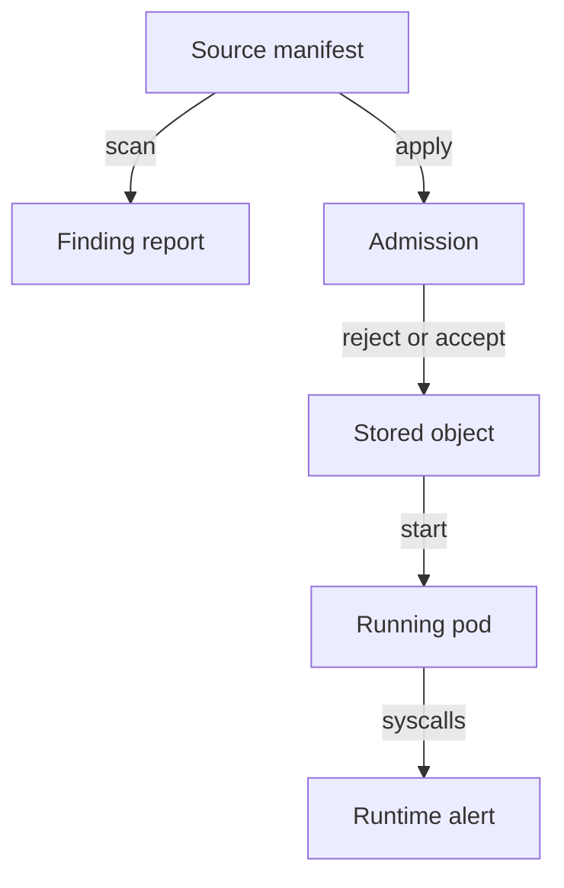

# What Security Automation Can Establish

A scanner reports that the `probe` Deployment has a risky privilege setting. At the same moment, an admission rule in the cluster is set to report only, and a runtime detector is not installed. Does the cluster now prevent a second privileged pod? Does anyone know whether the existing one was abused? The answer to both questions is no, and the reason is that the three kinds of tool work at different decision points. This part explains each kind, what it proves and what it leaves open, and then shows how to read a single finding without over-trusting it.

## Scan, prevent and detect

Three kinds of automation appear in almost every compliance program. They differ in when they act and what data they see.

**Configuration scanning** compares inspected data with a set of rules. The data can be manifest files in a repository, objects exported from a cluster, or a Helm chart after rendering. Trivy is a configuration scanner: its `trivy config` command reads YAML and Dockerfiles and reports where a setting matches a known-risky pattern. A scanner changes nothing. It produces a report, and a person or a pipeline decides what to do with it.

**Policy enforcement** acts at a decision point. In Kubernetes the usual decision point is admission: the API server receives a request to create or change an object, calls admission controllers, and each one can accept or reject the request before the object is stored. Kyverno and ValidatingAdmissionPolicy are admission controllers. An enforcing policy needs three things to work: its scope must match the object, it must be set to reject and not only to report, and its failure behavior must be defined for the case where the policy engine does not answer.

**Runtime detection** observes what processes do while they run. Falco, for example, reads system calls from the Linux kernel and compares them with rules. It can see a shell that starts inside a container, which no manifest declares. It can only see what its sensor collects, and it usually raises an alert after the action started.

The diagram shows the three decision points in order: a scan reads the source, admission decides before an object is stored, and runtime detection watches the running pod.

## What each result does not prove

A result from one kind of tool does not carry over to the others. These are the gaps that matter most in an exam scenario and in real audits.

A clean scan does not mean the cluster is safe. The scan covered the files or objects it was given, with the rules of one version. A Pod created from a different manifest, or changed by a mutating webhook after the scan, was never inspected.

A policy in report mode does not prevent anything. Kyverno calls the modes `Audit` and `Enforce`. ValidatingAdmissionPolicy uses `validationActions` with `Warn`, `Audit` and `Deny`. Only `Enforce` and `Deny` reject a request. The other modes record a failure and let the request through.

A policy also does not act on objects that already exist. Admission runs only when a request arrives. A privileged pod that was created before the policy was installed keeps running. A background scan by the policy engine can still report it, and that report is a finding, not a prevention.

An empty list of runtime alerts does not prove that nothing happened. The rule may not cover the behavior, the sensor may not run on that node, or the event may have been dropped. Detection is evidence that something was seen, not a guarantee that nothing was missed.

## Reading one finding

A **finding** is the report that a rule matched an object or an observation met a condition. It is never the same thing as a problem in the real system. Four questions turn a finding into a decision.

First, which object does it describe? A finding for a Deployment manifest describes the pod template, not the pods that run today. After a rollout, or after an admission webhook adds fields, the running pod can differ from the template.

Second, which rule and which version produced it? A check that Trivy ships in one release can be renamed, split or removed in the next release. A finding is only comparable between two scans when the tool version and the rule set are recorded with it.

Third, does the described setting change real behavior? A manifest can set a restrictive field that a different field cancels. A `NetworkPolicy` object that exists does nothing when the cluster network plugin does not enforce network policies. A setting in a source file has no effect when the cluster applies a different file.

Fourth, is the finding a false positive or a false negative? A **false positive** is a reported problem that does not exist in context. A **false negative** is a real problem that the method failed to report. Scanners have both. A Deployment that the scanner marks as running as root, while a Pod Security Admission label rejects that pod anyway, is a finding without effect in that namespace.

## Example: the same setting at three layers

Take the setting `privileged: true` on the `probe` container. A configuration scanner reads the Deployment and reports a high-severity finding. An enforcing admission policy rejects any new pod with that setting and records the rejection in its own report. A runtime detector with a rule for privileged containers raises an alert when a container with that setting starts and when it opens a sensitive host path.

Each layer has a different evidence value. The scan shows that the setting exists in the declaration. The admission decision shows that the control worked at the moment of the request. The runtime alert shows what the workload did with the privilege. A complete answer to "is privileged execution controlled in this cluster?" uses the evidence from each layer that applies, and names the layers that are missing.

## Effective behavior versus declared settings

The source of a Kubernetes object is a YAML file, but the object that matters is the one the API server stored. Between the two, several components can change the result. A mutating admission webhook can add a sidecar container or a label. A controller can fill in defaults. A Deployment controller creates a ReplicaSet, and the ReplicaSet creates pods from a copy of the template.

For this reason a scan has a target type, and the type decides what the scan can claim. A scan of a file claims something about the file. A scan of a live Deployment claims something about the template the Deployment holds now. Only the live pod shows the settings the container runtime applied. When a control matters, check the layer that enforces it: the stored object for an admission result, the running pod for a security setting.

A simple habit helps here. After every fix, read the same field in two places: the object you changed and the running pod that the change created. If the two differ, the rollout has not finished or something rewrote the change.

## Prioritizing findings

Most scanners attach a severity label such as `LOW`, `MEDIUM`, `HIGH` or `CRITICAL`. The label comes from the rule author and describes a typical case. It does not know about your workload. A `HIGH` finding on a pod with no service account token and no network path is a smaller problem than a `MEDIUM` finding on a pod that holds a cluster-wide credential.

Rank findings by consequence, exposure and feasible misuse. Consequence is what an attacker gains: host access, a credential, data. Exposure is how an attacker reaches the object: through a Service, an Ingress, or another pod. Feasible misuse asks whether the attacker needs a second flaw first. Use the severity label as an input to that ranking and not as the result.

## Continuous assurance

A single scan describes one moment. Configurations change through deployments, emergency edits and upgrades, and vulnerability knowledge changes without any edit at all. Continuous assurance means that the checks run again as the inputs change, and that each run leaves a record.

Do not install overlapping tools only to raise the count. Name the question each tool answers and the decision it supports. A scanner in the pipeline answers "does this change introduce a known-risky setting?" An admission policy answers "may this object enter the cluster?" A runtime detector answers "did this process do something unexpected?" When two tools answer the same question, one of them is extra cost.

This part compared three kinds of tool and showed how to read a finding with scope, version and effective behavior.

A last point is ownership. A tool produces a finding, but a person owns the decision to fix it, to accept it or to reject it as a false positive. Write the owner next to the finding. A finding without an owner stays open and ages.

## Common pitfalls

> [!WARNING]
> - **Treating a scan as enforcement.** A scan reports. Only an admission policy in `Enforce` or `Deny` mode rejects a request.
> - **Treating a policy as a cleanup.** Admission does not remove objects that were created before the policy existed.
> - **Reading severity as risk.** The label describes a typical case. Rank by consequence, exposure and feasible misuse.
> - **Treating no alerts as no events.** A detector only reports what its rules and sensor cover.
> - **Comparing scans without versions.** A finding without the tool version, rule set and target has little value as evidence.
