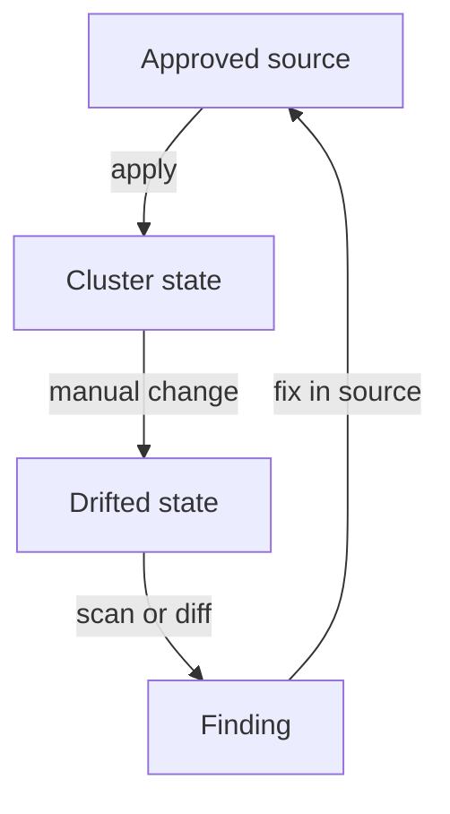

# Fix Drift And Record Exceptions

A finding that stays open is noise, and a finding that is hidden is a risk. Every finding ends in one of three ways: the setting is repaired, the risk is accepted for a limited time with a record, or the finding is shown to be a false positive. This part fixes one finding in the playground, proves the fix against the running pod, records an exception for a finding that cannot be fixed, and keeps the scan as evidence. It also explains control drift, the reason a fix must live in the approved source and not only in the cluster.

## Repair a finding and prove it

The commands below use the `trivy_scan` shell function. It exports the live Deployments `scout`, `probe` and `shuttle` and the exception register into the toolbox pod in `tools`, and runs `trivy config` there with the arguments you add. Paste it again if your terminal is new:

<!-- astrona:playground:renew -->

```sh
trivy_scan() {
  kubectl -n tools exec deploy/trivy -- sh -c 'rm -rf /work && mkdir -p /work/live'
  for name in scout probe shuttle; do
    kubectl -n starfleet get deployment "$name" -o yaml | kubectl -n tools exec -i deploy/trivy -- sh -c "cat > /work/live/$name.yaml"
  done
  kubectl -n tools get configmap trivy-exceptions -o jsonpath='{.data.trivyignore\.yaml}' | kubectl -n tools exec -i deploy/trivy -- sh -c 'cat > /work/trivyignore.yaml'
  kubectl -n tools exec deploy/trivy -- sh -c "cd /work && trivy config --quiet --skip-check-update --ignorefile trivyignore.yaml $* live"
}
```

The `probe` Deployment runs a container with `privileged: true`. A privileged container has almost all the capabilities of the node's root user and can access the host's devices. The repair is to set the field to `false`. A JSON patch replaces exactly one value and leaves the rest of the Deployment alone.

```sh
kubectl -n starfleet patch deployment probe --type=json -p '[{"op":"replace","path":"/spec/template/spec/containers/0/securityContext/privileged","value":false}]'
kubectl -n starfleet rollout status deployment/probe
```

The first command prints that the Deployment was patched. The second waits until the new pod is ready. The Deployment controller creates a new ReplicaSet with the changed template, starts a new pod from it, and then removes the old pod. The old pod, with `privileged: true`, only disappears at the end of this rollout.

Now prove the fix in two places. First read the field in the running pod, then scan again.

```sh
kubectl -n starfleet get pods -l app=probe -o jsonpath='{.items[*].spec.containers[*].securityContext}{"\n"}'
trivy_scan --severity HIGH,CRITICAL
```

The pod output now shows `"privileged":false`. The `probe` block of the scan no longer lists `KSV-0017`. The same scan can still list other checks for `probe`, such as `KSV-0014`, because the patch closed one finding and nothing else. If you rerun the scan right after the patch, before the rollout ends, the scan reads the new template while the old pod still runs. That is why the pod check comes first.

## Effective behavior is the proof

Rerunning the same scan that found the problem is a weak proof. It shows that the template changed. It does not show that the pod runs without the privilege, that the application still works, or that nothing changed the template back. Use a second check that comes from a different place. For this fix, three checks are enough: the running pod has no privileged container, the Deployment has all replicas available, and a client still gets an answer from the Service.

```sh
kubectl -n starfleet get deployment probe -o jsonpath='{.status.availableReplicas}{"\n"}'
kubectl -n starfleet exec deploy/shuttle -- curl -s -o /dev/null -w '%{http_code}\n' http://probe.starfleet.svc.cluster.local/get
```

The first command prints the number of available replicas, which is `1`. The second prints the HTTP status code that `probe` returns to a request from the `shuttle` pod, which is `200`. A fix that makes the pod fail to start would pass the scan and break the application. The behavior check catches it.

## Control drift

**Control drift** is a difference between the approved intent and the actual configuration. The approved intent is the configuration that the owners reviewed and that lives in a source of truth, for example a Git repository that a deployment tool applies. The actual configuration is what the cluster holds now.

Drift has common causes. An engineer runs `kubectl edit` during an incident and weakens a setting. A new Kubernetes version changes a default. A controller or webhook rewrites a field. An exception that was approved for one workload is copied to another. In every case the scan of the source stays clean while the cluster does not, or the other way around.

The patch you just ran is itself a change outside the source. If the source of `probe` still says `privileged: true`, the next deployment from that source puts the privilege back, and the finding returns. The repair is complete only when the approved source holds the same change. A tool that reconciles the cluster with the source, such as a GitOps controller, makes this rule automatic: it reverts every manual change that the source does not contain.



The diagram shows the loop: the source is applied, a manual change creates drift, a scan or a diff finds it, and the repair goes back into the source so that the next apply keeps it.

## An exception that cannot be repaired

The `shuttle` Deployment writes the file `/tmp/last-run` on its root file system. A read-only root file system, which the check `KSV-0014` asks for, would stop that write. The owner decides that the risk is acceptable for now. A finding that is accepted needs a record. Without a record it is invisible, and the next reviewer cannot tell an accepted risk from an overlooked one.

A good exception states the protected asset, the reason, the scope, the owner, the compensating measures and a review date. Trivy supports a YAML ignore file for the first parts. Each entry has `id`, `paths`, `statement` and `expired_at`. The field `id` names the check. The field `paths` limits the entry to some files. The field `statement` holds the reason, and Trivy does not use it for filtering. The field `expired_at` is a date, and after that date Trivy no longer ignores the finding, so it shows up again by itself.

The YAML ignore file is an experimental Trivy feature, so you must pass it with `--ignorefile`. The helper already does that. The register is a ConfigMap in `tools`, so the exception is itself an object with a history in the cluster. Choose a date that is not more than about 60 days away. The command differs by operating system: `date -u -d '+60 days' +%Y-%m-%d` on Linux and `date -u -v+60d +%Y-%m-%d` on macOS. Use that date in place of `<EXPIRY>`.

Save this as `configmap-trivy-exceptions.yaml`:

```yaml
apiVersion: v1
kind: ConfigMap
metadata:
  name: trivy-exceptions
  namespace: tools
data:
  trivyignore.yaml: |
    misconfigurations:
      - id: KSV-0014
        paths:
          - "live/shuttle.yaml"
        statement: "shuttle writes /tmp/last-run; owner starfleet-ops; compensating control: non-root user and all capabilities dropped"
        expired_at: <EXPIRY>
```

Apply it:

```sh
kubectl apply -f configmap-trivy-exceptions.yaml
```

Then check the result:

```sh
trivy_scan --severity HIGH,CRITICAL
```

The `shuttle` block no longer lists `KSV-0014`. The same check on `probe` is still listed, because the entry names only `live/shuttle.yaml`. This is the scope at work. An entry without `paths` would hide the finding on every workload, including ones that never needed the exception.

## Review, expiry and evidence

An automated tool can find an expired exception, but a person decides whether to renew it. At each review, ask whether the reason still holds, whether the owner is still right, and whether the compensating measures still work. If not, repair the finding and remove the entry. Do not hide an exception from a report to make the report look clean. The risk stays the same whether it is listed or not.

Evidence is the record that lets someone else check your claim later. A scan result is evidence only when it carries its context: the time, the target, the tool version, the rules and the observed state. Store the JSON report with those facts, and protect it from change. A checksum of the file lets a later reader see that it is unchanged.

```sh
trivy_scan --format json --severity HIGH,CRITICAL > scan-report.json
sha256sum scan-report.json
```

The first command writes the JSON report to a file on your machine. The second prints a SHA-256 checksum of that file. On macOS the command is `shasum -a 256 scan-report.json`. Keep the file and the checksum together with the date, the Trivy version (`0.76.1`) and the cluster name. A report without a target identity cannot show which environment was assessed. Reports can also contain object names and settings that an attacker would like to read, so store them with access control.

This part repaired a finding in the cluster, proved the repair with a second check, explained why the source must hold the same change, recorded a scoped and dated exception, and kept evidence. The open question is the control that stops the finding from coming back. A scan only reports, so something at admission has to reject such objects, and something at run time has to watch behavior.

## Common pitfalls

> [!WARNING]
> - **Fixing only the cluster.** A manual patch is overwritten by the next apply from the source. Put the same change in the approved source.
> - **Proving a fix with the same scan.** A clean rerun shows the template changed. Check the running pod and the behavior of the application too.
> - **Scanning before the rollout ends.** The old pod runs until the new one is ready. Wait for `rollout status` before you read the pod.
> - **An exception without scope or date.** An entry with no `paths` hides the finding everywhere, and an entry with no `expired_at` never returns.
> - **Evidence without context.** A report with no time, target and tool version cannot support a claim later.
