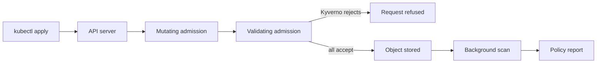

# Admission Policy With Kyverno

The `probe` Deployment in `starfleet` runs a privileged container. A scan can list it, but nothing stops a teammate from creating a second one tomorrow. An admission policy can. This part writes a Kyverno policy that checks privileged containers, runs it first in a mode that only records, reads what it recorded, and then switches it to a mode that rejects.

## Where admission policy acts

When you run `kubectl apply`, the request goes to the API server. The server authenticates and authorizes it, then calls **admission controllers**. A **mutating** controller may change the object. A **validating** controller may accept or reject it. Only after validation does the server store the object. Kyverno registers itself as a validating and mutating **admission webhook**: the API server sends it a copy of the request and waits for the answer.



The diagram shows two moments. At admission, Kyverno decides on the request. After the object is stored, a background scan checks existing objects against the policy and writes the result to a policy report. The background scan never removes an object. It only records.

## A first policy, in audit mode

A Kyverno **ClusterPolicy** is a cluster-wide object with a list of **rules**. Each rule has a `match` block that selects resources, and an action. The action used here is `validate`, which checks a resource against a pattern. The field `failureAction` under `validate` decides what happens when the check fails. `Audit` lets the request through and records the failure. `Enforce` rejects the request.

Pods are the objects that carry the setting, and Kyverno can generate matching rules for the controllers above them. When a rule matches `Pod`, Kyverno adds an **autogen** rule for Deployments, StatefulSets, DaemonSets, Jobs and CronJobs by default. A privileged Deployment is therefore checked too, not only a bare Pod.

Paste the two helpers first. `try_create` sends a file to the API server as a server-side dry run, so every admission check runs and nothing is stored. `failed_results` lists the failed results in the policy reports of a namespace.

<!-- astrona:playground:renew -->

```sh
try_create() {
  kubectl create --dry-run=server -f "$1"
}
failed_results() {
  kubectl -n "$1" get policyreport -o json | jq -r '.items[] | .scope as $s | .results[]? | select(.result=="fail") | [$s.kind,$s.name,.policy,.rule] | @tsv'
}
```

Write the policy to a file and apply it. The pattern uses the anchor `=(...)`, which means "if this field is present, it must match". A container without a `securityContext`, or without the `privileged` field, passes. A container with `privileged: true` fails.

```sh
cat > disallow-privileged.yaml <<'YAML'
apiVersion: kyverno.io/v1
kind: ClusterPolicy
metadata:
  name: disallow-privileged-containers
spec:
  background: true
  rules:
    - name: no-privileged
      match:
        any:
          - resources:
              kinds: ["Pod"]
              namespaces: ["starfleet"]
      validate:
        failureAction: Audit
        message: "Privileged containers are not allowed in starfleet."
        pattern:
          spec:
            =(initContainers):
              - =(securityContext):
                  =(privileged): "false"
            containers:
              - =(securityContext):
                  =(privileged): "false"
YAML
kubectl apply -f disallow-privileged.yaml
kubectl get clusterpolicy disallow-privileged-containers
```

Kyverno 1.19 may print a warning that `kyverno.io/v1` ClusterPolicy is deprecated in favor of newer policy types. The object is still created and works. The list command shows the policy and a `READY` column, which turns true after Kyverno has loaded the rule.

## Read the policy report

Kyverno writes results into **policy reports**, an API from the Kubernetes policy working group. There is one report for each resource that has results, in the namespace of the resource. A report has a `scope` that names the resource, a `summary` with counts, and a `results` list. Each result has the policy name, the rule name, a `result` value and a message. The values are `pass`, `fail`, `warn`, `error` and `skip`.

Wait a few seconds for the background scan, and read the failures:

```sh
failed_results starfleet
```

The output is a table with one line for each failed result. Expect lines for the `probe` pod, and for the `probe` Deployment through the autogen rule, with the policy name `disallow-privileged-containers`. An old ReplicaSet of `probe` can also appear after a rollout, because it keeps the old template. The exact lines depend on what exists in your cluster.

Now see what `Audit` does to a new request:

```sh
cat > pod-privileged-test.yaml <<'YAML'
apiVersion: v1
kind: Pod
metadata:
  name: priv-test
  namespace: starfleet
spec:
  containers:
    - name: test
      image: curlimages/curl:8.22.0
      command: ["sh", "-c", "sleep 3600"]
      securityContext:
        privileged: true
YAML
try_create pod-privileged-test.yaml
```

The dry run is accepted: the command prints one line for `priv-test` that ends in `(server dry run)`. The policy is in `Audit`, so the request passes. A real create would record a failed result and store the pod.

## Switch to Enforce

Change the action and apply the file again:

```sh
sed -i.bak 's/failureAction: Audit/failureAction: Enforce/' disallow-privileged.yaml
kubectl apply -f disallow-privileged.yaml
try_create pod-privileged-test.yaml
```

The `sed` flag `-i.bak` keeps a backup copy and works on both GNU and BSD `sed`. Kyverno needs a moment to use the changed policy, so repeat the dry run after a few seconds if it still passes. When the policy is active, the request is rejected with an error that starts with `admission webhook` and names the policy `disallow-privileged-containers` and the message you wrote. Nothing is stored.

Check that existing objects are unaffected:

```sh
kubectl -n starfleet get pods
```

The `probe` pod still runs. Admission acts on requests, so a pod that was created before the policy keeps running. The background scan still reports it as failed. To close the finding, change `probe` so that it is not privileged, and the new pod passes at admission.

## What can go wrong with the webhook

An admission webhook is a network service, and the API server must decide what to do if it does not answer. This is the **failure policy** of the webhook: `Fail` rejects the request when the webhook is unreachable, and `Ignore` lets it through. Kyverno's own webhooks have settings for this. A policy engine that is down with `Ignore` is a silent gap, and a policy engine that is down with `Fail` can block the cluster. Know which one your cluster uses, and monitor the engine like any other control.

Scope matters as much. The policy above matches `starfleet` only. A privileged pod in `outpost` passes, and that is correct for this rule, but it is also an example of how a policy covers less than people assume. Also, Kyverno policies are not applied to namespaces or resources that the installation excludes, such as its own namespace in the default configuration. When you review a policy, name the namespaces it does not cover.

## Reading a policy as evidence

A policy file shows intent. To use it as evidence of control, check four things in the live cluster: the policy exists and is ready, its action is `Enforce`, its match covers the intended resources, and a test request is rejected. The last check is the strongest, because it proves the effective behavior, which can differ from the declared one when a webhook is misconfigured or has not loaded the policy.

## Common pitfalls

> [!WARNING]
> - **Leaving a policy in `Audit` and calling it enforcement.** `Audit` records a failure and lets the request through. Check `failureAction`.
> - **Expecting a policy to remove existing objects.** Admission acts on requests. A pod created earlier keeps running and appears in the report as a failure.
> - **Reading failed results of old ReplicaSets as live risk.** A ReplicaSet keeps its old template after a rollout. Look at the `scope.kind` of the result.
> - **Matching too wide or too narrow.** The `match` block decides what is checked. Test a request inside and a request outside the scope.
> - **Ignoring the webhook failure policy.** A webhook that fails open is a silent gap. A webhook that fails closed can block work.
