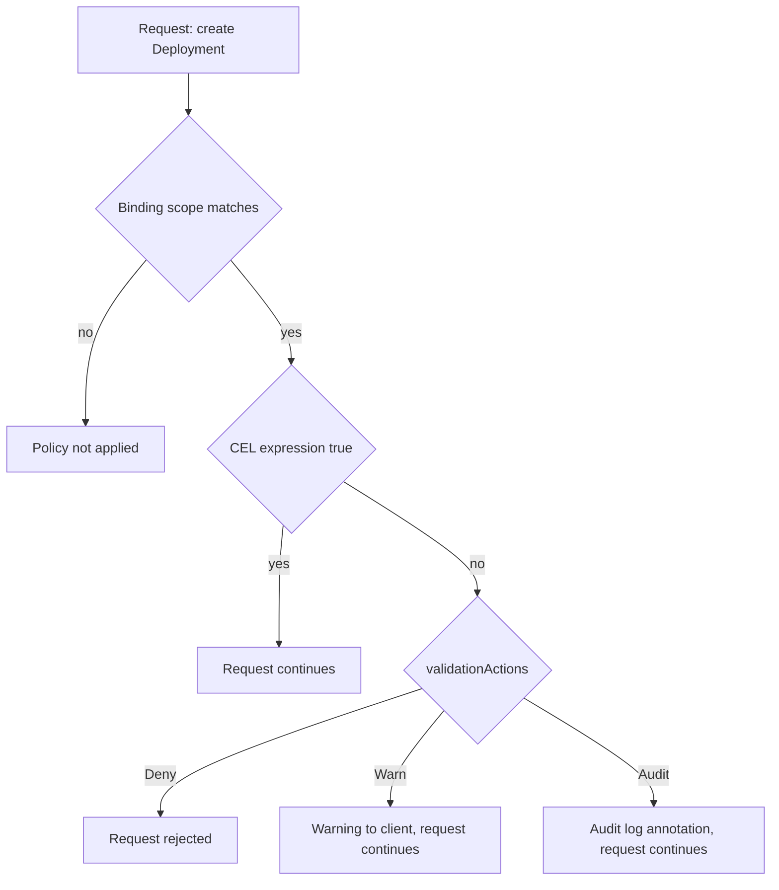

# Native Policy With ValidatingAdmissionPolicy

Kyverno is an add-on that runs as pods in the cluster. Kubernetes also has a policy feature built into the API server: the **ValidatingAdmissionPolicy**. It needs no webhook and no extra pods. The API server evaluates rules written in the Common Expression Language (CEL) inside its own process. This part writes a rule that requires an `owner` label on Deployments, tries it with each action, and limits it to one namespace.

## Three objects, one rule

A ValidatingAdmissionPolicy has two required halves and one optional half.

The **policy** (`ValidatingAdmissionPolicy`) holds the logic. It says which requests it looks at (`matchConstraints`) and which expressions must be true (`validations`). It also sets `failurePolicy`, which decides what happens if the policy cannot be evaluated, for example because an expression has an error: `Fail` rejects the request and `Ignore` lets it through.

The **binding** (`ValidatingAdmissionPolicyBinding`) turns the policy on. A policy without a binding does nothing. The binding names the policy, limits the scope with `matchResources` and sets the `validationActions`.

The optional third object is a **parameter** resource. The policy can read values from a ConfigMap or a custom resource, so one policy serves several bindings with different settings. This part does not use parameters.



The diagram shows the order: the binding scope is checked first, then the expression, and only a failed expression uses the action. The three actions can be combined in one list.

## The CEL expression

CEL is a small expression language. The policy exposes the request as variables. `object` is the new object, `oldObject` is the stored object on an update (empty on create) and `request` holds request fields such as the user name. An expression returns true when the request is acceptable.

For the owner label the expression has three parts, joined by `&&`: the object has a `labels` map, the map contains the key `owner`, and the value is not empty. CEL evaluates a chain from left to right and stops early, so the `has()` test protects the later lookups from an error on a missing field. When a field may be absent, test with `has()` before you read it.

## Write and bind the policy

Paste the helper first. It sends a file to the API server as a server-side dry run, so the admission check runs and nothing is stored.

<!-- astrona:playground:renew -->

```sh
try_create() {
  kubectl create --dry-run=server -f "$1"
}
```

Write the policy and a binding that starts with `Warn`:

```sh
cat > require-owner.yaml <<'YAML'
apiVersion: admissionregistration.k8s.io/v1
kind: ValidatingAdmissionPolicy
metadata:
  name: require-owner-label
spec:
  failurePolicy: Fail
  matchConstraints:
    resourceRules:
      - apiGroups: ["apps"]
        apiVersions: ["v1"]
        operations: ["CREATE", "UPDATE"]
        resources: ["deployments"]
  validations:
    - expression: "has(object.metadata.labels) && 'owner' in object.metadata.labels && object.metadata.labels['owner'] != ''"
      message: "Every Deployment must carry a non-empty owner label."
---
apiVersion: admissionregistration.k8s.io/v1
kind: ValidatingAdmissionPolicyBinding
metadata:
  name: require-owner-label-starfleet
spec:
  policyName: require-owner-label
  validationActions: ["Warn"]
  matchResources:
    namespaceSelector:
      matchLabels:
        kubernetes.io/metadata.name: starfleet
YAML
kubectl apply -f require-owner.yaml
```

The two objects are created in one command. The field `operations` lists the request types: `CREATE` and `UPDATE` cover new and changed Deployments. The binding scope uses the label `kubernetes.io/metadata.name`, which Kubernetes sets on every namespace with the namespace name. This makes a namespace selector by name possible without labeling the namespace yourself.

Write a Deployment without an owner label and try to create it:

```sh
cat > deploy-no-owner.yaml <<'YAML'
apiVersion: apps/v1
kind: Deployment
metadata:
  name: nolabel
  namespace: starfleet
spec:
  replicas: 1
  selector:
    matchLabels:
      app: nolabel
  template:
    metadata:
      labels:
        app: nolabel
    spec:
      containers:
        - name: test
          image: curlimages/curl:8.22.0
          command: ["sh", "-c", "sleep 3600"]
YAML
try_create deploy-no-owner.yaml
```

The API server needs a few seconds to start using a new policy, so repeat the command if it prints no warning. With `Warn`, the request is accepted, and `kubectl` prints a line that starts with `Warning:` and holds your message. The Deployment would be stored. This is the mode to use when you want users to see a rule before it blocks them.

## Change to Deny

Edit the binding and apply it again:

```sh
sed -i.bak 's/validationActions: \["Warn"\]/validationActions: ["Deny"]/' require-owner.yaml
kubectl apply -f require-owner.yaml
try_create deploy-no-owner.yaml
```

After a few seconds the request is rejected. The error names the policy `require-owner-label` and the binding, and repeats your message. A rejected request stores nothing.

Now check the scope. Change the namespace in the file and try again:

```sh
sed 's/namespace: starfleet/namespace: outpost/' deploy-no-owner.yaml > deploy-outpost.yaml
try_create deploy-outpost.yaml
```

The request is accepted, because the binding matches `starfleet` only. Add a label under the Deployment `metadata` (`labels: {owner: starfleet-ops}` next to the `app` key, or a new `labels` block) and the `starfleet` request passes too. A label only in the pod template does not count here, because the expression reads `object.metadata.labels`, the labels of the Deployment itself.

## Actions and where each one shows

`Deny` rejects the request and the client sees the message. `Warn` sends a warning in the response, which the client shows. `Audit` adds an annotation to the audit event in the API server audit log, named `validation.policy.admission.k8s.io/validation_failure`. It shows nothing to the client and needs an audit policy that records the request. This is the key difference from Kyverno: there is no policy report, so the evidence for `Audit` lives in the audit log, and a reader needs access to it.

## Native policy compared with Kyverno

A ValidatingAdmissionPolicy runs in the API server, so there is no webhook to be unreachable, and the request path has fewer moving parts. It only validates. It does not generate objects, it does not scan existing objects in the background, and it has no report object. Kyverno adds mutation, generation, background scans and reports, at the cost of running a controller and a webhook. Neither tool replaces the other. Name the question first: "must this request be rejected?" suits both. "Which existing objects violate the rule?" needs a scan or a report.

## Existing objects

Like every admission control, this policy acts on requests. The three Deployments `scout`, `probe` and `shuttle` already exist without an owner label. They keep running. The first update of one of them, for example a new image, is a request that matches the rule, so it is rejected until the label is added. Plan this in advance, or the first emergency change fails at the worst moment.

```sh
kubectl -n starfleet label deployment scout owner=starfleet-ops
```

The label change is an update to the Deployment, and it passes, because it adds the label the rule requires. The expression sees the new object, not the stored one.

## Common pitfalls

> [!WARNING]
> - **Creating a policy and no binding.** A ValidatingAdmissionPolicy does nothing until a binding names it.
> - **Choosing `Warn` or `Audit` and expecting a block.** Only `Deny` rejects a request.
> - **Reading a field without `has()`.** A missing field makes the expression fail, and the `failurePolicy` decides if that rejects the request.
> - **Reading the pod template instead of the object.** `object.metadata.labels` is the Deployment. The pod labels are in `object.spec.template.metadata.labels`.
> - **Forgetting existing objects.** They are not removed, and their next update must pass the rule.
