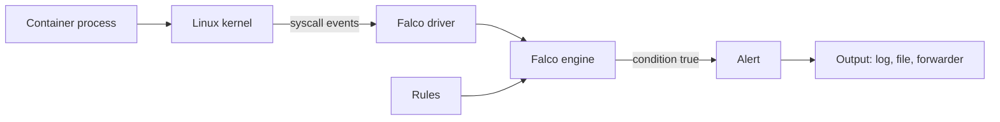

# Reading Falco Rules

An admission policy decides about a request. It cannot see what a container does after it starts. A shell opened with `kubectl exec` into a running pod, a process that reads a credential file, a program that changes a system file: none of these is a Kubernetes API object that a policy can match. **Falco** is a runtime detection tool built for this gap. This part teaches you to read a Falco rule and to reason about the events it sees. Falco is not installed in the playground, because the sensor needs kernel access that a kind node does not provide reliably. The part has no commands, and you read the rules as text.

## What Falco sees

A **system call** (syscall) is a request from a process to the Linux kernel: open a file, start a program, connect to a host. Every container shares the kernel of its node, so every action of every container goes through syscalls. Falco hooks this stream. A **driver** in the kernel (a modern eBPF probe or a kernel module) collects the events. The Falco **engine** in user space enriches each event with context, such as the container and, through the Kubernetes metadata, the pod and namespace, and compares it with the loaded rules. When a rule condition is true, Falco writes an **alert** to its outputs: standard output, a file, or a forwarder.



The diagram shows that the rules are input to the engine and that detection happens after the syscall already occurred. Falco, by default, observes and reports. It does not stop the process.

## Anatomy of a rule

A rule is a YAML object. Here is a simplified rule that detects a shell started inside a container, with the macros and the list it uses:

```yaml
- list: shell_binaries
  items: [bash, sh, zsh, ash, dash]

- macro: spawned_process
  condition: evt.type in (execve, execveat) and evt.dir = <

- macro: container
  condition: container.id != host

- rule: Terminal shell in container
  desc: A shell was started in a container with an attached terminal.
  condition: >
    spawned_process and container
    and proc.name in (shell_binaries)
    and proc.tty != 0
  output: >
    Shell started in a container
    (user=%user.name container=%container.name pod=%k8s.pod.name
    ns=%k8s.ns.name shell=%proc.name parent=%proc.pname cmdline=%proc.cmdline)
  priority: NOTICE
  tags: [container, shell]
```

Read it from the top.

A **list** is a named set of values. A **macro** is a named piece of condition that other conditions reuse. They keep rules short and let you change a value in one place. The macro `spawned_process` is true for an `execve` or `execveat` event, which are the syscalls that start a program. The sign `evt.dir = <` selects the exit side of the call, so the event is complete and holds the result values.

The **rule** has five fields you must be able to read. `desc` says in plain words what the rule detects. `condition` is a boolean expression over event fields. `output` is the message template for the alert. `priority` sets how serious the alert is. `tags` group rules for filtering.

## The condition field by field

The condition has four parts joined by `and`, and an alert fires only when all are true.

- `spawned_process` means a new program started.
- `container` means the event happened in a container, and not on the host. The field `container.id` holds the container ID, and the value `host` marks host processes.
- `proc.name in (shell_binaries)` means the program name is one of the listed shells. `proc.name` is the name of the executable.
- `proc.tty != 0` means the process has a terminal attached. A shell started by `kubectl exec -it` has one. A shell started by a script usually has none, so the last part separates interactive use from scripted use.

Field names have a prefix that tells where the value comes from: `evt.` for the event, `proc.` for the process, `container.` for container metadata, `user.` for the user and `k8s.` for Kubernetes metadata. The Kubernetes fields exist only when Falco can read the metadata of the container. If it cannot, they print as `<NA>`, and an alert has less context.

## The output and the priority

The output is a template. Each `%field` is replaced by the value from the event. In the example, the alert shows who ran the shell, in which container, pod and namespace, which shell, the parent process and the full command line. The template decides what an investigator has to work with, so include enough fields to find the pod without a second tool.

Priorities are, from the most to the least severe, `EMERGENCY`, `ALERT`, `CRITICAL`, `ERROR`, `WARNING`, `NOTICE`, `INFORMATIONAL` and `DEBUG`. Falco has a configured minimum priority, and rules below it are not loaded. The label is chosen by the rule author, like a scanner severity. A shell in a container is `NOTICE` in the sample rule because administrators do it legitimately. In a production namespace that has no reason for an interactive shell, the same event deserves a higher priority.

## Reasoning about events

Take five events and decide whether the rule fires.

| Event | Fires | Why |
| --- | --- | --- |
| `kubectl exec -it` starts `bash` in the `probe` pod | Yes | New program, in a container, name in the list, terminal attached |
| A cron job in the pod starts `sh -c` with no terminal | No | `proc.tty` is 0 |
| An administrator runs `bash` on the node | No | `container.id` is `host` |
| `kubectl exec` starts `python3` in the pod | No | The name is not in the list |
| The container image renames a shell binary to `tools` | No | The rule matches the name, so a renamed binary is a false negative |

The last row is the useful one. A rule that matches by name can be bypassed by a changed name, and a rule that matches too broadly raises alerts for legitimate work. The first is a **false negative**, the second a **false positive**. Tuning a rule is the work of balancing the two, usually by adding **exceptions**, which are named lists of conditions where the rule is skipped, for example a known maintenance tool.

## What an alert proves

An alert shows that an event met the condition on a node where the sensor ran. It does not show intent. It does not show what the shell did next. To learn that, a rule for the follow-up actions has to exist, or someone has to look at other evidence. The alert gives a time, a container, a pod and a command line, and these are the starting points of an investigation.

The reverse is also true. No alert does not prove that nothing happened. The rule may not cover the behavior, the sensor may not run on that node, the driver may have dropped events under load, or an output may have failed. A control that has never fired has not necessarily been tested. Test a detection rule by causing the event in a safe environment and confirming the alert appears.

## Detection in a compliance loop

Falco and an admission policy complement each other. Admission rejects what it can describe in an object before it is stored. Runtime detection reports what only becomes visible when the process runs. In a compliance loop, a Falco alert is an input that starts the same cycle as a scan finding: find the object, decide whether the behavior was expected, fix the configuration or add an exception, and keep the alert as evidence.

## Common pitfalls

> [!WARNING]
> - **Expecting Falco to block.** By default Falco reports. Stopping a process needs a separate response step.
> - **Matching on a name and calling it covered.** A renamed binary does not match. Think about how the rule can be bypassed.
> - **Trusting silence.** No alert can mean no event, no sensor on that node, or a rule that does not cover the behavior.
> - **Reading priority as risk.** The label comes from the rule author. Judge the event in its context.
> - **Missing Kubernetes metadata.** Fields such as the pod and namespace need metadata from the cluster. Without it, the alert holds less context.
